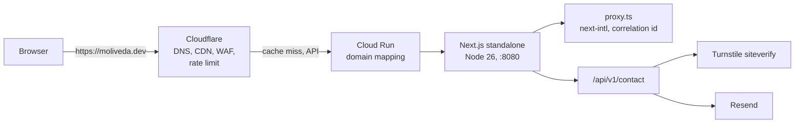

# MASTERPLAN: moliveda_web

Personal portfolio website of **Mauricio Oliveda**, served at [https://moliveda.dev](https://moliveda.dev).

| Item         | Value                                             |
| ------------ | ------------------------------------------------- |
| Product type | `web`                                             |
| Repository   | `moliveda_web` (public, GitHub owner `M-oliveda`) |

---

## 1. Goals and non-goals

### Goals

- Let future clients and companies understand Mauricio's skills, experience and education in under two minutes.
- Ship in four languages (English default, Spanish, Portuguese, French) with path-based locales and `Accept-Language` negotiation on first visit.
- Offer a resume viewer and download, per locale.
- Offer a contact form that delivers email through Resend, protected against spam.
- Show clean code quality in a public repository: strict TypeScript, 100% unit/integration coverage, end-to-end tests, CI/CD to Google Cloud Run.
- Keep the running cost low (free tiers of Cloudflare, Docker Hub and Cloud Logging, and Cloud Run where it applies). Production keeps one instance warm so the site stays online. Every other environment scales to zero.

### Non-goals (for v1.0.0)

- No database, no CMS, no user accounts, no blog.
- No newsletter (deferred, see Phase 8).
- No Terraform (infrastructure is bootstrapped with documented `gcloud` scripts).
- No Google Artifact Registry. Images live on Docker Hub only.
- No message queue or background worker (one email per submission, sent inline).
- No outside contributions. This is a personal portfolio: no `CONTRIBUTING.md`, no issue templates.

---

## 2. Decisions

### 2.1 Confirmed with the owner

| #   | Decision                                                                                                                                                                                                                                                                          |
| --- | --------------------------------------------------------------------------------------------------------------------------------------------------------------------------------------------------------------------------------------------------------------------------------- |
| D1  | Next.js (latest stable) App Router, TypeScript, Tailwind CSS, shadcn-style components sourced from the owner's [origin-ui](https://github.com/m-oliveda/origin-ui_web) repo.                                                                                                      |
| D2  | `framer-motion` for animation, `zod` for validation, `next-intl` for i18n.                                                                                                                                                                                                        |
| D3  | Locales `en` (default), `es`, `pt`, `fr`. Path-based, always prefixed (`/en/...`). `/` redirects to the best match from `Accept-Language`.                                                                                                                                        |
| D4  | Pages follow the Google Stitch design: About, Experience, Education, Skills (with contact call to action), plus Contact and Resume modals.                                                                                                                                        |
| D5  | Skills use level labels **Beginner / Intermediate / Advanced** (Native for Spanish). No numeric metrics or invented statistics anywhere.                                                                                                                                          |
| D6  | French is a **Beginner** language and the site is fully translated into French.                                                                                                                                                                                                   |
| D7  | Professional title displays as "Professional Software Developer". Badge "Open to remote work" stays (config flag).                                                                                                                                                                |
| D8  | Backend is Next.js Route Handlers (REST, versioned `/api/v1`). Resend sends mail from `contact@moliveda.dev` (domain verified in Resend).                                                                                                                                         |
| D9  | Spam protection: honeypot + Zod validation (client and server) + Cloudflare Turnstile, plus Cloudflare's edge rate limit on the contact API.                                                                                                                                      |
| D10 | Hosting on Google Cloud Run. One GCP project per environment (the existing shared projects). Images stored in a public Docker Hub repository.                                                                                                                                     |
| D11 | Environments: `local`, `development`, `staging`, `production`, plus an ephemeral `preview` per pull request. Development, preview and staging scale to zero. Production stays available.                                                                                          |
| D12 | Only production gets the `moliveda.dev` domain. Other environments use the default `*.run.app` URL, printed at the end of the CI/CD job.                                                                                                                                          |
| D13 | All secrets, including production runtime secrets, live in GitHub Environment secrets and are injected by CI/CD. The environments are `develop`, `preview`, `staging` and `production`. Google Secret Manager is not used.                                                        |
| D14 | Testing: 100% coverage on unit and integration tests, plus Playwright end-to-end tests.                                                                                                                                                                                           |
| D15 | Analytics: Cloudflare Web Analytics (privacy-friendly, cookieless beacon).                                                                                                                                                                                                        |
| D16 | Public repository. Code under a strong copyleft license, personal content reserved (see section 11).                                                                                                                                                                              |
| D17 | Public email on the site: `maurioliveda@gmail.com` (copy action, obfuscated in HTML). The form sends from `contact@moliveda.dev`.                                                                                                                                                 |
| D18 | The Origin UI design system, documented in `DESIGN.md` (supplied by the owner), is the single source of truth for typography, color, spacing, radius, breakpoints, dark mode and the component catalogue. `DESIGN.md` is copied to the repo root and referenced from `AGENTS.md`. |

### 2.2 Owner decisions and deviations

#### Owner decisions

| #   | Decision                                                                                                                                                                                                                                                                                                                                                                                                                                                                                                                                                                                                                                                                                                                                    |
| --- | ------------------------------------------------------------------------------------------------------------------------------------------------------------------------------------------------------------------------------------------------------------------------------------------------------------------------------------------------------------------------------------------------------------------------------------------------------------------------------------------------------------------------------------------------------------------------------------------------------------------------------------------------------------------------------------------------------------------------------------------- |
| D19 | Region **`us-central1`** for every Cloud Run service. It supports Cloud Run domain mapping and is in the lowest price tier.                                                                                                                                                                                                                                                                                                                                                                                                                                                                                                                                                                                                                 |
| D20 | **Docker Hub is the only registry.** No Artifact Registry (standard or remote). Cloud Run pulls the public images directly. The manifest names each image by a tag that is unique to the run attempt, Cloud Run pins the revision to the digest it resolves, and CI checks that digest against the one it pushed (10.4). Tag scheme in 10.4.                                                                                                                                                                                                                                                                                                                                                                                                |
| D21 | Reuse the existing projects `moliveda-gcloudprojects-{dev,prev,stg,prod}` and their shared Workload Identity pool, provider and deployer service accounts. Preview gets its own project (`prev`). Each project already has a budget cap.                                                                                                                                                                                                                                                                                                                                                                                                                                                                                                    |
| D22 | **Cloudflare (free plan)** in front of production: DNS moves from Namecheap to Cloudflare (the registrar stays Namecheap), the record is proxied, and Cloudflare adds the CDN, WAF managed rules, an edge rate limit on the contact API and the `www` redirect. Cloud Run domain mapping connects `moliveda.dev` to the service. Details in 10.6.                                                                                                                                                                                                                                                                                                                                                                                           |
| D23 | Production stays online with `min-instances 1`. Development, preview and staging scale to zero. Cloudflare still caches public pages.                                                                                                                                                                                                                                                                                                                                                                                                                                                                                                                                                                                                       |
| D24 | Non-production contact: `EMAIL_DRIVER=fake` on `development` and `preview`. `staging` uses Resend (test recipient) and **real** Turnstile keys for its hostname. Turnstile test keys are used only locally and in CI.                                                                                                                                                                                                                                                                                                                                                                                                                                                                                                                       |
| D25 | **NGINX basic-auth gate** in front of `development`, `preview` and `staging` (two containers per Cloud Run service, probes exempt). Production has no gate. (section 8.1).                                                                                                                                                                                                                                                                                                                                                                                                                                                                                                                                                                  |
| D26 | All locale text, UI strings **and** personal content, lives in **`messages/{locale}/`**, split into namespaces and merged in `src/i18n/request.ts`, as the next-intl docs recommend (section 4.4). `src/content/` is dropped.                                                                                                                                                                                                                                                                                                                                                                                                                                                                                                               |
| D27 | Coverage stays at **100%**. The only exceptions are file-level exclusions in `vitest.config.ts`, each with a comment. No inline `v8 ignore` comments.                                                                                                                                                                                                                                                                                                                                                                                                                                                                                                                                                                                       |
| D28 | Every runtime secret (`RESEND_API_KEY`, `TURNSTILE_SECRET_KEY`, `ORIGIN_VERIFY_SECRET`, and `ORIGIN_VERIFY_SECRET_PREVIOUS` while rotating) lives in the matching GitHub Environment, including `production`, and is injected at deploy time. Google Secret Manager is not used.                                                                                                                                                                                                                                                                                                                                                                                                                                                            |
| D29 | Release tags `vX.Y.Z` and GitHub Releases are created **only by `deploy-prod.yml`**, after the production smoke test passes. Humans bump the version on the release branch, never tag by hand.                                                                                                                                                                                                                                                                                                                                                                                                                                                                                                                                              |
| D30 | Contributions are not accepted. The README says so. A PR template stays as the owner's own checklist.                                                                                                                                                                                                                                                                                                                                                                                                                                                                                                                                                                                                                                       |
| D31 | Commit messages use **Gitmoji**, enforced by `.husky/commit-msg` (same script as the owner's reference project).                                                                                                                                                                                                                                                                                                                                                                                                                                                                                                                                                                                                                            |
| D32 | Accessibility target is **WCAG 2.2 AA**. Lighthouse: Accessibility, Best Practices, SEO and CLS fail CI; Performance, LCP and TBT warn.                                                                                                                                                                                                                                                                                                                                                                                                                                                                                                                                                                                                     |
| D33 | Agent rules are enforced by `.claude/settings.json` (deny and ask lists), not only by prose in `AGENTS.md`.                                                                                                                                                                                                                                                                                                                                                                                                                                                                                                                                                                                                                                 |
| D34 | **Origin protection.** A Cloudflare Transform Rule adds `X-Origin-Verify: <secret>` to every proxied request. In production the app answers `403` to any request without a matching value (`/health` and `/ready` excepted), with a constant-time comparison in `src/lib/origin-guard.ts`, applied in `proxy.ts` and in the API routes. The secret lives in the `production` GitHub Environment (`ORIGIN_VERIFY_SECRET`); `ORIGIN_VERIFY_SECRET_PREVIOUS` allows rotation without downtime. Only verified requests trust `CF-Connecting-IP`. The `run.app` URL stays enabled so the candidate smoke test can reach the no-traffic revision; the smoke test sends the header, read from the `production` GitHub Environment by the deployer. |
| D35 | **Signed commits only.** The rulesets on `main` and `develop` require signed commits. Merges made through GitHub are signed by GitHub. The `pre-commit` hook fails early when `commit.gpgsign` is not `true`, and agents never pass `--no-gpg-sign`.                                                                                                                                                                                                                                                                                                                                                                                                                                                                                        |
| D36 | **Cloud Run services are deployed from a rendered manifest** (`gcloud run services replace`), not from `gcloud run deploy` flags. A gated service needs a startup probe on its `app` container and a start order (`gate` after `app`), and the CLI cannot set the probe for multi-container services. `scripts/deploy/render-service.ts` builds the manifest from `scripts/deploy/deploy-plan.ts`. Secrets go into the `0600` manifest file, each only to the container that needs it, never onto a command line, and the file is deleted after the deploy. This replaces `--env-vars-file`.                                                                                                                                                |
| D37 | **Production gets its own deployer**, `moliveda-web-deployer`, holding only the custom role `molivedaWebDeployer` (no `run.services.delete`). The shared deployer of the production project is not changed. Development, preview and staging keep using their shared deployers (D21). The shared Workload Identity providers are never changed by this repository's scripts.                                                                                                                                                                                                                                                                                                                                                                |

#### Deviations from the charter (each one is deliberate)

| #   | Charter says                                                    | This project does                                                                                                                    | Reason                                                                                                                                                                    |
| --- | --------------------------------------------------------------- | ------------------------------------------------------------------------------------------------------------------------------------ | ------------------------------------------------------------------------------------------------------------------------------------------------------------------------- |
| V1  | Define only four environments, "never design other types"       | Adds an ephemeral `preview` environment per PR                                                                                       | Explicit owner request. It is PR-scoped, lives in the preview GCP project, sits behind the gate and is deleted on PR close.                                               |
| V2  | Production secrets come from a secrets manager                  | Every environment, including production, uses GitHub Environment secrets injected at deploy time. Google Secret Manager is not used. | Explicit owner request. Trade-off: deployed values are visible to anyone who can view the Cloud Run service, including production. Acceptable for a single-owner project. |
| V3  | Prefer Server Actions for Next.js forms                         | REST Route Handler `POST /api/v1/contact`                                                                                            | Owner requires RESTful APIs, and a versioned endpoint is easy to test over HTTP.                                                                                          |
| V4  | `lint` script uses `eslint '*.{js,jsx,ts,tsx}'`                 | `eslint --max-warnings=0` (flat config, whole project)                                                                               | The charter glob only matches root files, so it would skip `src/`.                                                                                                        |
| V5  | Airbnb base config for JS/React ESLint                          | `eslint-config-next` (core-web-vitals) + `typescript-eslint` (type-checked) + Prettier                                               | Next.js ships its own maintained flat config; Airbnb is specified for plain JS/React/Vue.                                                                                 |
| V6  | Expose `/metrics` (Prometheus) and a tracing backend            | Cloud Run and Cloud Monitoring built-in metrics, Cloud Logging, Error Reporting, Cloud Trace via OpenTelemetry (Phase 6)             | Running Prometheus for one container is overkill. All three signals are still covered.                                                                                    |
| V7  | TanStack Query for all async fetching, Zustand for global state | Neither is installed                                                                                                                 | No client-side data fetching beyond one POST and no global state (theme uses `next-themes`). Add them only if a real need appears.                                        |
| V8  | Message queue for slow work                                     | Email is sent inline                                                                                                                 | One email per submission is fast. A queue would add infrastructure with no benefit. The EmailSender port keeps this swappable.                                            |

### 2.3 Assumptions and open items (confirm before the phase that needs them)

| #   | Item                                                                                                                        | Default used in this plan                                                                                                                                                                                                                                                            | Needed by |
| --- | --------------------------------------------------------------------------------------------------------------------------- | ------------------------------------------------------------------------------------------------------------------------------------------------------------------------------------------------------------------------------------------------------------------------------------ | --------- |
| A1  | License choice: GPL-3.0 vs AGPL-3.0                                                                                         | **Resolved:** code under `AGPL-3.0-only`; personal content All Rights Reserved, declared in `REUSE.toml` and the README, with no separate content license file (section 11)                                                                                                          | —         |
| A2  | Portuguese variant                                                                                                          | **Resolved:** Brazilian Portuguese (`pt`, `<html lang="pt-BR">`)                                                                                                                                                                                                                     | —         |
| A3  | Spanish variant                                                                                                             | **Resolved:** neutral Latin American Spanish                                                                                                                                                                                                                                         | —         |
| A4  | Technical skill levels (resume gives none)                                                                                  | Owner assigns Beginner/Intermediate/Advanced per skill when the content is written, using the definitions in Appendix B                                                                                                                                                              | Phase 5   |
| A5  | Resume PDFs per locale                                                                                                      | Generated from `messages/{locale}/content/` by a print route and Playwright `page.pdf()` (tagged, with outline) in a CI job on the Playwright image, **before** `docker build`, because Playwright browsers do not run on Alpine. Falls back to English if a locale file is missing. | Phase 5   |
| A6  | Institution photo in the Education mockup                                                                                   | Owner supplies an image they own (or a neutral illustration) at the start of Phase 4                                                                                                                                                                                                 | Phase 4   |
| A7  | Cloud Run region                                                                                                            | **Resolved:** `us-central1`                                                                                                                                                                                                                                                          | —         |
| A8  | How `moliveda.dev` reaches Cloud Run                                                                                        | **Resolved:** domain mapping + Cloudflare proxy                                                                                                                                                                                                                                      | —         |
| A9  | GCP project IDs, Docker Hub namespace, GitHub owner                                                                         | **Resolved:** existing projects. Docker Hub namespace stays the `DOCKERHUB_USERNAME` variable.                                                                                                                                                                                       | —         |
| A10 | `origin-ui` component list                                                                                                  | Catalogue supplied in `DESIGN.md`. Owner still pastes the source of each component the site actually uses (see 4.3). The repo itself could not be read during planning.                                                                                                              | Phase 4   |
| A11 | Stitch design tokens (colors, fonts, spacing) and dark mode palette                                                         | Resolved by `DESIGN.md` (brand palette, semantic tokens for light and dark, Space Grotesk). Stitch has no dark screens, so dark mode comes from the tokens.                                                                                                                          | Phase 4   |
| A12 | Accounts needed: Resend (done), Cloudflare (DNS, Turnstile, Web Analytics), Docker Hub, GCP billing (done)                  | Owner creates them when the CI/CD pipelines are set up and tells the agent                                                                                                                                                                                                           | Phase 2-7 |
| A13 | Light-theme focus ring and status-color contrast (see 2.4)                                                                  | **Resolved:** `--ring` is `brand-600` in light mode, full-opacity ring with an offset, status colors never used as text on light surfaces; fix `origin-ui` later (2.4)                                                                                                               | —         |
| A14 | `origin-ui` primitives                                                                                                      | **Confirmed:** Base UI (`@base-ui/react`), see 2.4                                                                                                                                                                                                                                   | —         |
| A15 | Origin protection for production                                                                                            | **Resolved:** secret origin header checked by the app                                                                                                                                                                                                                                | —         |
| A16 | Signed commits required by the ruleset                                                                                      | **Resolved:** required                                                                                                                                                                                                                                                               | —         |
| A17 | Artifact Registry remote repository for Docker Hub (Google's recommendation for availability, used by other owner projects) | **Open:** Docker Hub only (D20), with run-unique tags and a digest check after each deploy (10.4). Adopting it changes D20, the bootstrap and the deployer roles                                                                                                                     | Owner     |

### 2.4 What `DESIGN.md` changes

#### Applied to this plan

- Font: **Space Grotesk** only, loaded with `next/font` (self-hosted at build time). Phase 4 verifies glyph coverage for the characters the four languages need (ç, ã, õ, é, è, ê, à, ñ, œ, «»).
- Colors: only the brand palette (`brand-50` to `brand-950`) and the semantic and status tokens. No arbitrary values (`bg-[#...]`) and no `dark:` color prefixes where a semantic token exists. A script, `npm run check:design`, fails the build on those patterns (pre-commit and CI).
- Dark mode: `.dark` class on `<html>` through `next-themes`, exactly as planned. The dark palette is now defined, so it ships in Phase 4.
- Components: shadcn/ui `base-nova` style, imported from `@/components/ui/*`. The catalogue has about 55 components. **Port only what the site uses**, because every ported component must reach 100% coverage and adds bundle weight. Expected set: Button, Badge, Card (and parts), Avatar, Separator, Dialog, Tooltip, ToggleGroup (language switcher), Field, Label, Input, Textarea, Spinner, Skeleton, Alert, Sonner (contact feedback), Collapsible (academic scope), Item (list rows).
- The `Sidebar` component is **not** used. The profile card is composed from Card, Avatar and Badge, and mobile uses the bottom navigation from the Stitch design.
- Type scale, spacing, radius (`rounded-lg` for cards, `rounded-2xl` for dialogs) and breakpoints (`sm`, `md`, `lg`, `xl`, `2xl`) are used as documented.

#### Owner decision: contrast fixes for the light theme

Measured with the WCAG contrast formula on the hex values in `DESIGN.md`:

| Pair (light mode)                                          | Ratio             | Needed        | Result                                   |
| ---------------------------------------------------------- | ----------------- | ------------- | ---------------------------------------- |
| `brand-950` / `brand-800` / `brand-600` text on `brand-50` | 19.9 / 13.1 / 7.8 | 4.5           | Pass                                     |
| `brand-600` on `brand-100`                                 | 5.98              | 4.5           | Pass                                     |
| `ring` (`brand-300`) on `brand-50`                         | 2.17              | 3 (UI states) | **Fail**. `ring-ring/50` is lower still. |
| `brand-300` on `brand-100`                                 | 1.66              | 3             | **Fail**                                 |
| `success` text on `brand-50`                               | 2.54              | 4.5           | **Fail**                                 |
| `warning` text on `brand-50`                               | 2.15              | 4.5           | **Fail**                                 |
| `error` text on `brand-50`                                 | 3.76              | 4.5           | **Fail** (passes only for large text)    |
| `brand-300` on `brand-950` (dark focus ring)               | 9.19              | 3             | Pass                                     |

The dark-mode "dark teal shade" tokens (`secondary`, `muted`, `accent`, `border` 16%, `input` 20%, `card` and `popover` 14%) have no hex values in `DESIGN.md`, so they cannot be measured yet. Phase 4 needs the `origin-ui` `globals.css` (its exact CSS variables) to define the tokens and measure them, for example `muted-foreground` (`brand-300`) on a dark teal `card`. Verified against the copied `DESIGN.md`: every light-mode ratio in the table above is correct.

**Focus ring (decided):** override `--ring` in light mode inside this project's `globals.css` to `brand-600` (7.79:1 on `brand-50`, 5.98:1 on `brand-100`). Dark mode keeps `brand-300` (9.19:1 on `brand-950`). The ring is drawn at full opacity with a 2 px offset in the `background` color, so it sits on the page surface and not on the component fill: `ring-ring/50` fails at any color, so the focus classes of `DESIGN.md` rule 8 change to `focus-visible:ring-2 focus-visible:ring-ring focus-visible:ring-offset-2 focus-visible:ring-offset-background`. Later, the same fix goes into `origin-ui` so every project benefits. The keyboard-walk test in section 7 measures the ring contrast in both themes, so a regression fails CI.

**Status colors (decided):** use them for dots, icons and borders only, and keep the text in a foreground token. This includes **`destructive`**, which `DESIGN.md` maps to the error red (3.76:1 on white): shadcn's `FieldError` and the destructive `Alert` use `text-destructive` by default, so their text changes to `text-foreground` with a red icon and a red border. No new red hex value is added, because `DESIGN.md` forbids colors outside its palette. In dark mode the error red reaches 5.29:1 on `brand-950`, but the same pattern is used in both themes for consistency. For example, the green "In Progress" label in the Education mockup becomes a green dot plus `text-foreground` or `text-muted-foreground` text.

**Confirmed:** `origin-ui` uses **Base UI** underneath, not Radix. The primitives package is `@base-ui/react` (1.9.x, MIT license, checked on npm). It becomes a dependency, and its MIT notice goes into `THIRD_PARTY_NOTICES.md`. Do not add any `@radix-ui/*` package. Pasted components must import from `@base-ui/react`. If a pasted component imports the older `@base-ui-components/react` package (a 1.0 release candidate), update it to `@base-ui/react`.

---

## 3. Tech stack

Versions were read from the npm registry. Pin exact versions at scaffold time (`npm view <pkg> version`) and commit the lockfile. `.npmrc` sets `save-exact=true` and `engine-strict=true`.

| Area             | Choice                                                                                                     | Version         | Notes                                                                                                                                                                                                                                                  |
| ---------------- | ---------------------------------------------------------------------------------------------------------- | --------------- | ------------------------------------------------------------------------------------------------------------------------------------------------------------------------------------------------------------------------------------------------------ |
| Runtime          | Node.js 26 LTS ("Lithium")                                                                                 | 26.x            | Entered LTS on 2026-10-28. Confirm with `node -p process.release.lts`. Fallback: Node 24 ("Krypton"). `.nvmrc` pins the major, `engines` in `package.json` enforces it.                                                                                |
| Framework        | Next.js (App Router)                                                                                       | 16.4.x          | Next 16 renamed `middleware.ts` to `proxy.ts`. Turbopack is the default bundler. Read `node_modules/next/dist/docs/` before using an API.                                                                                                              |
| UI library       | React                                                                                                      | 19.3.x          |                                                                                                                                                                                                                                                        |
| Language         | TypeScript (`strict: true`)                                                                                | 6.0.x           | Phase 1 check: `typescript-eslint` 8.74 supports TypeScript `<6.1.0`, so 7.0 is blocked. Move to 7.x when `typescript-eslint` supports it.                                                                                                             |
| Styling          | Tailwind CSS                                                                                               | 4.3.x           | `@tailwindcss/turbopack` loader in `next.config.ts`, as `create-next-app` 16.4 sets it up (no PostCSS config). Tokens live in `globals.css`.                                                                                                           |
| Components       | `origin-ui` (shadcn-style)                                                                                 | local source    | shadcn/ui `base-nova` style on Base UI primitives (`@base-ui/react` 1.9.x), defined by `DESIGN.md`. Only the components the site uses are pasted into `src/components/ui/`. shadcn CLI 4.23.x only if a registry is later published.                   |
| Icons            | lucide-react                                                                                               | 1.80.x          |                                                                                                                                                                                                                                                        |
| Animation        | framer-motion                                                                                              | 14.14.x         | `LazyMotion` + `domAnimation` + `m` components. Wrap the app in `MotionConfig reducedMotion="user"`.                                                                                                                                                   |
| i18n             | next-intl                                                                                                  | 4.16.x          | Routing, negotiation, messages and content, typed messages, `hreflang` alternates.                                                                                                                                                                     |
| Validation       | Zod                                                                                                        | 4.6.x           | Contact form, API input, env, content schemas. `z.config({ jitless: true })` for the CSP.                                                                                                                                                              |
| Forms            | react-hook-form + @hookform/resolvers                                                                      | 7.92.x / 7.0.x  | Zod resolver.                                                                                                                                                                                                                                          |
| Theming          | next-themes                                                                                                | 0.4.x           | Light/dark with CSS variables.                                                                                                                                                                                                                         |
| Email            | resend                                                                                                     | 6.39.x          | Behind an `EmailSender` interface. Sends with an `Idempotency-Key` (kept 24 h by Resend).                                                                                                                                                              |
| Bot protection   | Cloudflare Turnstile                                                                                       | n/a             | Server-side token verification, `hostname` and `action` checked.                                                                                                                                                                                       |
| Edge             | Cloudflare (free plan)                                                                                     | n/a             | DNS, proxy, CDN, WAF managed rules, one rate-limit rule, redirect rule.                                                                                                                                                                                |
| Logging          | pino                                                                                                       | 10.4.x          | JSON to stdout with Cloud Logging field names, `redact` paths.                                                                                                                                                                                         |
| Unit/integration | Vitest + @vitest/coverage-v8                                                                               | 5.1.x           | jsdom environment for components, `// @vitest-environment node` for server modules.                                                                                                                                                                    |
| Component tests  | React Testing Library + user-event                                                                         | 16.3.x / 14.6.x |                                                                                                                                                                                                                                                        |
| HTTP mocking     | msw                                                                                                        | 3.0.x           | Mocks Resend and Turnstile at the HTTP boundary (`onUnhandledFrame: "error"`).                                                                                                                                                                         |
| End-to-end       | Playwright + @axe-core/playwright                                                                          | 1.65.x          | Chromium (desktop and mobile) in CI; Firefox, WebKit and mobile Safari locally and weekly.                                                                                                                                                             |
| Lint / format    | ESLint 9.39.x, eslint-config-next 16.4.x, typescript-eslint, Prettier 3.10.x + prettier-plugin-tailwindcss | n/a             | Charter `.prettierrc.json` plus the Tailwind plugin. Phase 1 check: `eslint-config-next` bundles `eslint-plugin-react`, `-jsx-a11y` and `-import`, which support ESLint 9 at most, so ESLint 10 is blocked. Boundaries use `eslint-plugin-boundaries`. |
| Git hooks        | Husky 9.1.x + lint-staged 17.6.x                                                                           | n/a             | pre-commit, commit-msg (Gitmoji), pre-push (section 9).                                                                                                                                                                                                |
| Container        | Docker (multi-stage)                                                                                       | n/a             | `node:26.x.y-alpine3.24` and `nginxinc/nginx-unprivileged:1.31.7-alpine3.24` (mainline; the stable 1.30.6 image had critical NGINX CVEs), both pinned by tag **and** digest.                                                                           |
| Hosting          | Google Cloud Run                                                                                           | n/a             | One service per environment, `us-central1`.                                                                                                                                                                                                            |
| Registry         | Docker Hub (public)                                                                                        | n/a             | See 10.4. No Artifact Registry.                                                                                                                                                                                                                        |
| CI/CD            | GitHub Actions                                                                                             | n/a             | Workload Identity Federation to GCP. Actions pinned to commit SHAs.                                                                                                                                                                                    |
| Analytics        | Cloudflare Web Analytics                                                                                   | n/a             | Manual beacon snippet (automatic injection stays off because of the CSP).                                                                                                                                                                              |

Package manager: **npm** (charter default).

---

## 4. Architecture

A single Next.js application. Pages are statically rendered per locale and cached by Cloudflare. One Route Handler handles the contact form. Everything else is static assets.



Non-production services add the NGINX gate as the ingress container:

```text
client ─► [ nginx gate:8080, basic auth ] ─► [ next app:3000 ]
```

### 4.1 Routing and locale negotiation

- `src/i18n/routing.ts`: `locales: ["en", "es", "pt", "fr"]`, `defaultLocale: "en"`, `localePrefix: "always"`.
- `src/proxy.ts` uses next-intl's `createMiddleware(routing)`. On `/` it picks the best locale from the `NEXT_LOCALE` cookie first, then `Accept-Language`, then falls back to `en`. The language switcher keeps the current path and sets the cookie (`SameSite=Lax`, `Secure` in production, `Path=/`) so the choice sticks.
- The `/` redirect varies per visitor, so it is sent with `Vary: Accept-Language, Cookie` and `Cache-Control: private, no-store`, and the Cloudflare cache rule bypasses it.
- The proxy matcher excludes `api`, `health`, `ready`, `_next`, `.well-known`, and any path with a file extension.
- `generateStaticParams` returns all four locales. `generateMetadata` emits canonical URL, `hreflang` for each locale (`en`, `es`, `pt-BR`, `fr`) and `x-default` pointing to `/en`. A test checks the alternates are reciprocal.
- `<html lang>` is set per locale (`en`, `es`, `pt-BR`, `fr`).

### 4.2 Pages and UI (from the Stitch design)

| Route                     | Content                                                                                                                          |
| ------------------------- | -------------------------------------------------------------------------------------------------------------------------------- |
| `/[locale]`               | About: headline, summary, role, key technologies.                                                                                |
| `/[locale]/experience`    | SmartUp and Freelance entries.                                                                                                   |
| `/[locale]/education`     | UNL degree, Jala bootcamp, language levels, independent studies (French).                                                        |
| `/[locale]/skills`        | Skills grouped by category with Beginner/Intermediate/Advanced tags, plus contact call to action ("Let's build something good"). |
| `/[locale]/privacy`       | Privacy notice (LGPD and GDPR), linked from the contact form and the footer.                                                     |
| `/[locale]/accessibility` | Accessibility statement (Phase 8).                                                                                               |
| Modal: Contact            | Form plus a copyable email and quick contact actions.                                                                            |
| Modal: Resume             | PDF viewer, download button, locale-aware.                                                                                       |

Shell (shared layout):

- Desktop: left profile card (initials/photo, name, professional title "Professional Software Developer", "Open to remote work" badge, location, primary track) and a top bar with nav (About, Experience, Education, Skills), the EN/ES/PT/FR switcher, theme toggle and a "Contact Me" button.
- Mobile: bottom navigation bar (as in the Stitch mobile screens). Mobile dark-mode variants are suggested in Stitch but not generated yet.
- Footer: privacy notice, source code link (AGPL), copyright.
- Dark mode: implemented with the `.dark` class, CSS variables and `next-themes`. Light and dark values come from `DESIGN.md` (see 2.4).
- Error pages: `[locale]/error.tsx` (shows the error `digest`, never the message), a root `global-error.tsx`, `[locale]/not-found.tsx` and a root `not-found.tsx` for paths outside a locale. Turnstile and the PDF viewer have their own error boundaries.
- Content stays visible without JavaScript: above-the-fold content is not animated in, and reveals only start after hydration.

### 4.3 Design system (`origin-ui`)

- `DESIGN.md` at the repo root is authoritative. Anything it does not list (colors, fonts, components) is not invented.
- The owner pastes the source of each component the site uses (expected set in 2.4). Components land in `src/components/ui/` with their own tests, which count toward the 100% coverage.
- Third-party code inside `origin-ui` (shadcn/ui and Base UI) keeps its original MIT notices in `THIRD_PARTY_NOTICES.md`.
- Colors come from the tokens in `globals.css`. `npm run check:design` rejects arbitrary color values and `dark:` color prefixes in `src/`.
- Icons: `lucide-react` with `size-4` inline, `size-5` actions, `size-6` features.
- Focus style follows `DESIGN.md` rule 8 with the contrast fix decided in 2.4 (light-mode `--ring` is `brand-600`, full opacity, with an offset).

### 4.4 Locale content model (no database)

Everything a visitor reads is in one place per locale, loaded by next-intl. The next-intl docs recommend keeping messages in the repo under `messages/` (so their shape can be type-checked) and allow splitting a locale into several files merged in `getRequestConfig`.

```text
messages/
├── en/
│   ├── ui.json              # buttons, labels, nav, errors, form copy (AGPL-3.0)
│   ├── metadata.json        # titles, descriptions, Open Graph text (AGPL-3.0)
│   ├── privacy.json         # privacy notice (AGPL-3.0)
│   └── content/             # personal content (All Rights Reserved, section 11)
│       ├── profile.json     # Profile namespace
│       ├── experience.json  # Experience namespace
│       ├── education.json   # Education namespace
│       └── skills.json      # Skills namespace
├── es/...
├── pt/...
└── fr/...
```

- `src/i18n/request.ts` imports the files for the requested locale and merges them into one messages object (one top-level namespace per file).
- **Typed messages:** `AppConfig` is augmented with `Messages` inferred from `messages/en/*`, so a missing or misspelled key is a compile error.
- **Lists** (experience entries, education programs, skill groups) are objects with stable, non-numeric keys (`"smartup"`, `"freelance"`), not arrays. Components read the keys from the namespace (the documented `useMessages`/`getMessages` pattern for lists whose size can differ per locale) and render each entry with `t(\`${key}.title\`)`.
- **Structured values** (dates, skill levels, URLs) are stored as ISO dates and enum values, never as preformatted text. Dates and lists are formatted with next-intl's formatter (`dateTime`, `list`), so "Nov 2024 – Apr 2026" and "Present" are correct in every locale.
- **One accessor for every consumer:** `src/i18n/content.ts` exposes typed functions (`getProfile(locale)`, `getExperience(locale)`, ...) that read the content namespaces through `getTranslations`/`getMessages` and parse them with the Zod schemas in `src/i18n/content-schema.ts`. Pages, the resume print route, JSON-LD, Open Graph images, `sitemap.ts` and metadata all use it, so nothing is duplicated.
- Rich text uses `t.rich` with one shared `RichText` component (the documented replacement for `defaultTranslationValues`).
- **Missing messages:** `onError` and `getMessageFallback` throw in tests and CI, and in production log a warning with the key and render the English string. A raw key is never rendered.
- **Parity test:** fails if any locale is missing a key, has an extra key, contains an empty string, or fails the content schema.
- Skill levels use a union type: `"beginner" | "intermediate" | "advanced" | "native"`.
- Translation review status per locale is recorded in `messages/REVIEW.md` (reviewer, date). French needs a native review before launch.
- Source of truth for the first draft: the owner's resume (Appendix B).

### 4.5 Contact API

`POST /api/v1/contact` (Route Handler, Node runtime). The route is a thin adapter. The logic lives in `handleContact(input, deps)` in `src/features/contact/service.ts`, with injected `{ emailSender, turnstile, rateLimiter, clock, logger }`.

Request body (validated by the shared Zod schema in `src/features/contact/zod.ts`):

| Field            | Rule                                                      |
| ---------------- | --------------------------------------------------------- |
| `name`           | trimmed string, 1-100 chars, no CR/LF                     |
| `email`          | valid email, max 254                                      |
| `message`        | trimmed string, 10-4000 chars                             |
| `locale`         | one of the four locales                                   |
| `website`        | honeypot, must be empty                                   |
| `turnstileToken` | required string                                           |
| `submissionId`   | client-generated UUID, used as the Resend idempotency key |

Flow (cheap checks first, so invalid floods cost nothing):

1. Read or create `x-correlation-id` (accepted only if it matches `^[A-Za-z0-9._-]{1,128}$`).
2. `Content-Type` must be `application/json`, otherwise `415`. Requiring JSON forces a CORS preflight, which blocks cross-site form posts.
3. `Origin` must match `NEXT_PUBLIC_SITE_URL`, otherwise `403`.
4. Body at most 16 KiB (measured in bytes), otherwise `413`.
5. Rate limit per client IP (in-memory fixed window, see 4.8 for how the IP is derived). Over the limit: `429` with `Retry-After`. Cloudflare's edge rule is the first line in production.
6. Parse JSON (`400 invalid_json`), then validate with Zod (`400` with field errors).
7. Honeypot filled: return the **same** `200` shape as success with a generated id, send nothing, log at `warn`.
8. Verify the Turnstile token server-side with `remoteip`, a 5 s timeout, and checks on `success`, `hostname` and `action: "contact"`. Rejected token: `403`. Cloudflare unreachable: `503` (fail closed).
9. Send through `EmailSender` with a 10 s timeout and `Idempotency-Key: <submissionId>`. One retry on network errors and `5xx` only. Provider failure: `502` with a generic message and a logged provider error id.
10. Success: `200` with `{ "status": "sent", "id": "<provider message id>" }`.

The response bodies are one discriminated union, `ContactResponseBody`, shared by the route and the client. The client (`contact-client.ts`) maps every outcome to a `ContactSubmitResult` and never throws. The OpenAPI description is in `docs/api/openapi.yaml`, generated from the Zod schema (`z.toJSONSchema`), and a test fails when it is stale.

Email contents: `from: Portfolio <contact@moliveda.dev>`, `to: CONTACT_TO_EMAIL`, `replyTo` set to the visitor, subject `New message from <name>`, plain-text body plus an HTML body with all user values escaped. **No auto-reply** is ever sent to the visitor's address, which would let anyone send email to any address through the form.

Client behavior: the submit button is disabled while pending, a 429 shows when to retry, a failure keeps what was typed, the Turnstile widget is reset after a failure and refreshed when its token expires (300 s), errors are announced and focus moves to the first invalid field.

Design: a small port/adapter layer (SOLID, Factory):

```text
EmailSender (interface)
├─ ResendEmailSender    # staging and production
└─ FakeEmailSender      # local, tests, e2e, development and preview (EMAIL_DRIVER=fake)
createEmailSender(env)  # factory
```

Staging sets `CONTACT_TO_EMAIL` to Resend's test address so no real mail is sent. Turnstile test keys are used only locally and in CI; staging and production use real keys for their hostnames.

### 4.6 Resume viewer

- Files: `public/cv/{locale}/Mauricio_Oliveda_Resume_{locale}.pdf`, generated from the content namespaces.
- The modal embeds the PDF with `<object>` and a visible fallback link, because mobile browsers often cannot embed PDFs. The download button uses `<a download>`.
- CSP allows `object-src 'self'` and `frame-src 'self'` for this.
- If a locale file does not exist yet, the English PDF is served and the UI says so.
- Tests: each PDF exists, its text can be extracted and it stays under a size budget.

### 4.7 Configuration and environment variables

All config is read through one validated module (`src/lib/env.ts`, Zod, `import "server-only"`). `parseEnv(source)` is pure and tested; `getEnv()` caches the result. Empty strings count as unset. `EnvValidationError` lists the failing keys only, never values. The app **fails closed**: in any non-local environment it refuses to start (checked in `instrumentation.node.ts`, which calls `process.exit(1)` because Next.js only logs errors thrown from `register`) if a required variable is missing.

`NEXT_PUBLIC_*` values are inlined at build time. Because of that, CI builds one image per environment, passing public values as build arguments. Server secrets are never build arguments. They are injected at runtime on Cloud Run. The trade-off (the production image is not the exact image verified on staging) is listed in the README "Known gaps"; reading public values at runtime and promoting one digest is the documented upgrade path.

The complete variable list is in `README.md`.

### 4.8 Security

- Validate all input with Zod on the server, even if the client already did. Modules that touch secrets start with `import "server-only"`.
- Security headers are built by a pure, tested function in `src/lib/security-headers.ts` and sent from `next.config.ts` (`poweredByHeader: false`): `Content-Security-Policy`, `Strict-Transport-Security`, `X-Content-Type-Options`, `Referrer-Policy`, `Permissions-Policy`, `Cross-Origin-Opener-Policy: same-origin`, `X-Frame-Options: DENY`.
- CSP: `default-src 'self'`; `script-src 'self'` + `https://challenges.cloudflare.com` + `https://static.cloudflareinsights.com`; `frame-src 'self' https://challenges.cloudflare.com`; `connect-src 'self' https://cloudflareinsights.com`; `object-src 'self'` (PDF); `base-uri 'self'`; `form-action 'self'`; `frame-ancestors 'none'`. `'unsafe-eval'` only under `next dev`. It ships as `Content-Security-Policy-Report-Only` in development and staging first, reporting to `POST /api/v1/csp-report` (rate limited, size limited, logged at `warn`), and is enforced in production once the reports are clean. Nonce-based CSP is evaluated in Phase 6; nonces force dynamic rendering, so any remaining `'unsafe-inline'` is documented as a known gap.
- Cloudflare features that inject or rewrite scripts (Rocket Loader, Email Obfuscation, automatic Web Analytics injection) stay off, because the CSP would block them.
- **Client IP for rate limiting:** in production, `CF-Connecting-IP`, trusted only on requests that passed the origin guard. Behind the gate, `X-Real-IP` set by NGINX from the rightmost `X-Forwarded-For` entry. Earlier `X-Forwarded-For` entries are never trusted. Tested with crafted headers.
- **Origin guard:** in production, every request except `/health` and `/ready` must carry `X-Origin-Verify` matching `ORIGIN_VERIFY_SECRET` (or `ORIGIN_VERIFY_SECRET_PREVIOUS` during a rotation), otherwise `403` with no body. The comparison is constant-time and the header is redacted from logs. Outside production the guard is off, so the gate and local runs are unaffected.
- `.dev` domains are HSTS-preloaded, so HTTPS is mandatory everywhere on `moliveda.dev`.
- Public repository rules: no secrets in code or history, `.env` is gitignored, `.env.example` lists names only, secret scanning and push protection enabled on GitHub, gitleaks in pre-commit and CI, Dependabot enabled, `npm audit --omit=dev --audit-level=high` blocking in CI.
- Non-production environments are behind the NGINX gate, send `X-Robots-Tag: noindex, nofollow` (gate and app) and serve `Disallow: /` in `robots.txt`, which reads `APP_ENV` at runtime (`connection()`).
- Email addresses in HTML are obfuscated against scrapers. The copy action reveals them at click time.
- Vulnerability disclosure: `SECURITY.md`, GitHub private vulnerability reporting, and `/.well-known/security.txt` (RFC 9116) served by a tested route.

### 4.9 SEO, accessibility, performance

- SEO: per-locale titles and descriptions, canonical, `hreflang`, `sitemap.ts` (4 locales × 5 pages), `robots.ts`, Open Graph and Twitter images per locale, JSON-LD `ProfilePage` with a `Person` main entity (`sameAs` LinkedIn and GitHub, `knowsLanguage`, `alumniOf`).
- Accessibility: **WCAG 2.2 AA**, one `<h1>` per page, a single `<main>`, skip link, visible focus with at least 3:1 contrast that is never hidden under the top bar or the bottom navigation, target size at least 24 px, dialog focus management from the component primitives, never color alone for meaning, `prefers-reduced-motion` respected.
- Performance: `next/image` (AVIF/WebP, `qualities` set, as Next.js 16 requires) with explicit sizes, `next/font`, Server Components by default (`"use client"` only for the shell interactions, the form, dialogs, theme and language switcher), lazy-load the PDF modal and Turnstile, `LazyMotion` for animation. Static pages send `Cache-Control: public, max-age=0, s-maxage=3600, stale-while-revalidate=86400` so Cloudflare serves them.
- Budgets: Lighthouse (mobile, production build, all pages in `en` and `fr`): Accessibility, Best Practices and SEO 100 and CLS under 0.05 **fail** CI; Performance ≥ 95, LCP < 2.5 s and TBT < 200 ms **warn**. Route JavaScript is tracked by a size check in CI from Phase 1, measured first on the blank scaffold (the reference project's blank Next.js 16 page already shipped about 170 kB gzip).

### 4.10 Observability

| Signal  | Implementation                                                                                                                                                                                                                                                                                                                                    |
| ------- | ------------------------------------------------------------------------------------------------------------------------------------------------------------------------------------------------------------------------------------------------------------------------------------------------------------------------------------------------- |
| Logs    | Pino JSON to stdout. Fields: `severity`, `message`, `service: "moliveda-web"`, `env`, `correlationId`, Cloud Trace field `logging.googleapis.com/trace`. `redact` covers authorization, cookies, `x-origin-verify`, email, message, tokens and keys. Lengths and ids are logged instead of values. The gate logs JSON in the `httpRequest` shape. |
| Errors  | Errors are logged with their stack in the format Cloud Error Reporting recognizes, so they are grouped and alerted without another vendor.                                                                                                                                                                                                        |
| Metrics | Cloud Run built-in request count, latency and instance metrics in Cloud Monitoring. A log-based metric counts contact submissions by outcome. Cloudflare analytics shows edge traffic and cache hit ratio.                                                                                                                                        |
| Traces  | `X-Cloud-Trace-Context` correlation from Phase 3. OpenTelemetry exporter to Cloud Trace in Phase 6.                                                                                                                                                                                                                                               |
| SLOs    | Availability 99.5% per 28 days on `/ready` and the locale pages; p95 latency under 500 ms for static pages; contact success at least 99% excluding `4xx`. Cloud Monitoring SLOs with burn-rate alerts.                                                                                                                                            |
| Alerts  | Uptime check on `https://moliveda.dev/en` and `/ready`, SLO burn rate, contact failure rate, certificate expiry. Notifications to the owner's email. Alert policies and the dashboard are JSON files in `infra/gcp/monitoring/`.                                                                                                                  |

Correlation id: created in `proxy.ts` (or accepted from the caller if it matches the safe pattern), returned in the `X-Correlation-ID` response header, and attached to every log line.

Health endpoints (charter contract):

- `GET /health`: liveness, returns `200 {"status":"ok"}`. No dependency checks.
- `GET /ready`: readiness, returns `200` when configuration is valid and the email driver is initialized, otherwise `503`. It does **not** call Resend on every probe.
- Both call `await connection()` so they are never prerendered at build time (Next.js 16 Cache Components), send `Cache-Control: no-store`, are exempt from the gate's basic auth, and are not authenticated or logged per probe.

---

## 5. Folder structure

```text
moliveda_web/
├── .claude/
│   └── settings.json              # agent permissions: deny .env reads, ask before git writes and cloud CLIs
├── .github/
│   ├── workflows/
│   │   ├── ci.yml                 # quality, audit, e2e, lighthouse, docker, `CI passed`, then deploy calls
│   │   ├── build-push-deploy.yml  # reusable: build, push to Docker Hub, deploy to Cloud Run, smoke test
│   │   ├── deploy-preview.yml     # reusable: PR preview (same-repo PRs only) + PR comment
│   │   ├── deploy-env.yml         # reusable: develop → development, release/** → staging
│   │   ├── deploy-prod.yml        # reusable: main → production, then tag and GitHub Release
│   │   ├── cleanup-preview.yml    # PR closed: delete the preview service and its Docker Hub tags
│   │   ├── scheduled.yml          # weekly: full browser matrix, live Lighthouse, link check, audit, stale previews, Docker Hub tag pruning
│   │   └── scorecard.yml          # OpenSSF Scorecard
│   ├── CODEOWNERS
│   ├── dependabot.yml             # npm, github-actions, docker
│   ├── PULL_REQUEST_TEMPLATE.md   # the owner's verification checklist
│   └── release.yml                # release note categories
├── .husky/                        # pre-commit, commit-msg, pre-push
├── .vscode/                       # shared editor settings (Prettier, markdownlint) and recommended extensions
├── docker/
│   └── nginx/                     # basic-auth gate: nginx.conf.template, entrypoint.sh
├── docs/
│   ├── adr/                       # architecture decision records
│   ├── api/openapi.yaml           # /api/v1/contact, generated from Zod
│   └── runbooks/                  # rollback, secret rotation, contact delivery, domain, cost
├── e2e/                           # Playwright specs and fixtures
├── infra/
│   └── gcp/                       # idempotent gcloud bootstrap scripts, check.sh (drift), monitoring/*.json
├── LICENSES/                      # license texts for REUSE
├── messages/                      # {en,es,pt,fr}/ ui, metadata, privacy, content/*, REVIEW.md
├── public/
│   ├── profile/                   # owner photo (content license)
│   └── cv/{en,es,pt,fr}/          # resume PDFs (content license)
├── scripts/
│   ├── check-design.ts            # npm run check:design
│   └── test-gate.sh               # behavior test for the NGINX gate
├── src/
│   ├── app/
│   │   ├── [locale]/
│   │   │   ├── layout.tsx
│   │   │   ├── page.tsx           # About
│   │   │   ├── experience/page.tsx
│   │   │   ├── education/page.tsx
│   │   │   ├── skills/page.tsx
│   │   │   ├── privacy/page.tsx
│   │   │   ├── error.tsx
│   │   │   ├── not-found.tsx
│   │   │   └── opengraph-image.tsx
│   │   ├── .well-known/security.txt/route.ts
│   │   ├── api/v1/contact/route.ts
│   │   ├── api/v1/csp-report/route.ts
│   │   ├── health/route.ts
│   │   ├── ready/route.ts
│   │   ├── global-error.tsx
│   │   ├── not-found.tsx
│   │   ├── robots.ts
│   │   ├── sitemap.ts
│   │   └── globals.css            # Tailwind v4 config + design tokens
│   ├── components/
│   │   ├── ui/                    # origin-ui components
│   │   └── layout/                # app shell, profile card, nav, switchers, rich text
│   ├── features/
│   │   ├── contact/               # form, zod.ts, client, service, email senders, turnstile
│   │   └── resume-viewer/
│   ├── i18n/                      # routing.ts, request.ts, navigation.ts, content.ts, content-schema.ts
│   ├── lib/                       # env, logger, rate-limit, correlation-id, origin-guard, errors, security-headers, health
│   ├── test/                      # msw server, captureLogs, browser stubs (test-only)
│   ├── types/
│   ├── instrumentation.ts         # Node-only work in instrumentation.node.ts
│   ├── instrumentation.node.ts    # env validation at boot, OpenTelemetry later
│   └── proxy.ts
├── .dockerignore
├── .editorconfig
├── .env.example
├── .gitignore
├── .npmrc                         # save-exact, engine-strict, fund=false
├── .nvmrc
├── .prettierignore                # CLAUDE.md (formatted through AGENTS.md), DESIGN.md (verbatim upstream copy)
├── .prettierrc.json
├── AGENTS.md                      # single source of truth for AI agent context
├── CLAUDE.md                      # symlink to AGENTS.md
├── DESIGN.md                      # Origin UI design system (source of truth)
├── Dockerfile
├── docker-compose.yaml            # local development only (web, gate profile, e2e profile)
├── eslint.config.mts
├── LICENSE                        # AGPL-3.0-only (official text)
├── lighthouserc.json
├── MASTERPLAN.md
├── next.config.ts
├── package.json
├── playwright.config.ts
├── README.md
├── REUSE.toml                     # machine-readable code and content licensing
├── SECURITY.md
├── THIRD_PARTY_NOTICES.md
├── tsconfig.json
└── vitest.config.ts
```

Unit and component tests are **co-located** with the code (`*.test.ts(x)`), per the charter. End-to-end specs live in `e2e/`.

---

## 6. Conventions applied (from the charter)

- **TypeScript:** `strict` plus `noUncheckedIndexedAccess`, `noImplicitOverride`, `noFallthroughCasesInSwitch` (and `exactOptionalPropertyTypes` if the libraries allow it). No `any` (use `unknown`), explicit return types on public functions, `readonly` where possible, discriminated unions, custom `*Error` classes. Interfaces are prefixed with `I` (`IProfile`). React props types end in `Props` (`ButtonProps`). Constants in `UPPER_CASE`. `typecheck` runs `next typegen && tsc --noEmit`.
- **ESLint:** zero warnings; `no-console` (warn and error allowed), `eqeqeq`, `no-explicit-any: error`, `_`-prefixed unused vars; type-checked rules (`no-floating-promises`, `no-misused-promises`, `switch-exhaustiveness-check`); import ordering; **architecture boundaries** (`ui` imports nothing from `features`, features do not import each other, only `src/i18n/content.ts` reads the `content` namespaces); **no literal strings in JSX** under `src/components` and `src/features`.
- **React:** functional components with named functions, small focused components, custom hooks for reusable logic, `Suspense` fallbacks around Client Components, error boundaries on critical sections.
- **Next.js:** Server Components by default, route-specific components under `app/`, shared ones in `components/`, kebab-case directories, absolute imports with the `@/` alias, `generateMetadata`, loading/error/not-found files. `page.tsx`, `layout.tsx` and similar framework files may use default exports; everything else uses named exports.
- **Forms:** schemas live in a file named `zod.ts` next to the form, used with `useForm` and the Zod resolver, with explicit loading, error and success states.
- **Tailwind and design:** utility classes first, tokens and rules from `DESIGN.md` (semantic colors, Space Grotesk, spacing scale, radius tokens, `transition-colors`/`transition-all`), mobile-first, dark mode via variables, `@/components/ui/[component]` imports. Class order by `prettier-plugin-tailwindcss`.
- **Formatting:** the charter's Prettier config (80 columns, double quotes, semicolons, trailing commas `es5`, one attribute per line) plus the Tailwind plugin. Scripts: `format`, `format:check`, `lint`, and `verify` (all gates in order).
- **Secrets:** all-caps names in `.env`, never hardcoded, fail closed at startup.
- **Docs:** TSDoc on public APIs, README kept in sync, comments explain why, not what. Larger decisions get an ADR in `docs/adr/`.
- **Patterns used:** Factory (`createEmailSender`), port/adapter for email, one content accessor per locale (`src/i18n/content.ts`), Module pattern for `env` and `logger`, dependency injection for the contact service.

---

## 7. Testing strategy

Test pyramid: many unit tests, fewer integration tests, a handful of end-to-end tests.

| Layer         | Tooling                                     | What it covers                                                                                                                                                                                                                                                                                                                                                                                                                                                                                                                |
| ------------- | ------------------------------------------- | ----------------------------------------------------------------------------------------------------------------------------------------------------------------------------------------------------------------------------------------------------------------------------------------------------------------------------------------------------------------------------------------------------------------------------------------------------------------------------------------------------------------------------- |
| Unit          | Vitest                                      | Pure helpers, Zod schemas, env parsing, rate limiter, email builder, logger redaction (`captureLogs`), locale and sitemap helpers, content accessor, security headers.                                                                                                                                                                                                                                                                                                                                                        |
| Component     | Vitest + React Testing Library + user-event | Every UI component and feature component by role/label/text. Loading, error, empty and success states for the form and viewer.                                                                                                                                                                                                                                                                                                                                                                                                |
| Integration   | Vitest + msw                                | The contact Route Handler called with real `Request` objects (`415`, `403` origin, `413`, `429` with `Retry-After`, `400`, honeypot indistinguishable from success, Turnstile rejection and `hostname` mismatch, provider timeout, idempotency), the contact service with fakes, `/health` and `/ready`, message and content parity and schema across locales, sitemap and reciprocal `hreflang` output, proxy locale negotiation with different `Accept-Language` values and the `Vary` header, the OpenAPI spec is current. |
| End-to-end    | Playwright (+ axe)                          | `/` redirect by `Accept-Language` for each locale, language switch and persistence, navigation, theme toggle, resume modal open/download, contact happy path and error paths using `EMAIL_DRIVER=fake` and Turnstile test keys, mobile viewport nav, content visible with JavaScript disabled.                                                                                                                                                                                                                                |
| Accessibility | Playwright + axe                            | WCAG 2.0–2.2 A/AA and best-practice tags on every page × locale × theme and on open dialogs; one `h1` and no skipped heading levels; skip link first; a **keyboard walk** over every tab stop that checks the focus ring exists, contrasts at least 3:1 with its surface and is not hidden under the top bar or the bottom navigation; reduced-motion and motion-allowed runs.                                                                                                                                                |
| Security      | Playwright                                  | Origin guard in production (missing, wrong, current and previous secret, probes exempt); zero `securitypolicyviolation` events while loading every page, opening both modals and submitting the form; headers, `X-Robots-Tag` and `robots.txt` per `APP_ENV`; no `X-Powered-By`.                                                                                                                                                                                                                                              |
| Visual        | Playwright `toHaveScreenshot()`             | Every page × locale × theme at 390 and 1440 px, run in the `e2e` container for deterministic rendering, plus a pseudo-locale run for text expansion. Baselines change only in a reviewed PR.                                                                                                                                                                                                                                                                                                                                  |
| Containers    | `scripts/test-gate.sh`, CI `docker` job     | The gate (auth, fail-closed startup, open local mode, probes exempt, `X-Robots-Tag`, credentials stripped, 413, 429, JSON logs, no credentials in logs) and the `runner` image booting as non-root and answering `/health`.                                                                                                                                                                                                                                                                                                   |
| Mutation      | Stryker (weekly, on demand)                 | Contact feature, rate limiter, env and schemas, with a mutation-score threshold of 80%.                                                                                                                                                                                                                                                                                                                                                                                                                                       |

Rules:

- Coverage gate: **100% statements, branches, functions and lines** for `src/`, enforced in `vitest.config.ts` and in CI. End-to-end runs do not count toward the number.
- **Exclusions are file-level only, in `vitest.config.ts`, each with a comment.** No inline `v8 ignore` comments. The allowed exclusions are the thin route wrappers below, `*.config.*`, `src/types/**`, `*.d.ts`, `src/test/**` (test-only helpers), `instrumentation.ts` and `instrumentation.node.ts` (boot hooks; the validation they trigger is tested in `env.test.ts`).
- Async Server Components cannot be rendered by Vitest. Route files (`page.tsx`, `layout.tsx`, `opengraph-image.tsx`, `sitemap.ts`, `robots.ts`) therefore stay thin wrappers (a few lines) that delegate to tested, synchronous components and functions. They are exercised by Playwright.
- Mock only the boundary being replaced (HTTP via msw with `onUnhandledFrame: "error"`, the clock). Do not mock the module under test or the child components a screen renders.
- Test data builders stay next to their tests. No shared mutable fixtures. `MotionGlobalConfig.skipAnimations = true` in the Vitest setup.
- Playwright runs against the production build (`next build` then `next start`), never the dev server. CI runs the Chromium desktop and mobile projects; Firefox, WebKit and mobile Safari run locally and in the weekly scheduled workflow. Every browser-specific skip states its reason in the spec.
- Lighthouse CI runs on the production build with the budgets from section 4.9.

When tests run:

| Trigger                   | Runs                                                                                                                                                                                                      |
| ------------------------- | --------------------------------------------------------------------------------------------------------------------------------------------------------------------------------------------------------- |
| Pre-commit                | Blocked-file check, gitleaks, lint-staged (ESLint `--fix`, Prettier), typecheck                                                                                                                           |
| Pre-push                  | Vitest on tests related to changes since the upstream (full suite without one)                                                                                                                            |
| Every push and PR         | `npm run verify` (format check, lint, design check, typecheck, coverage gate, build), audit, gitleaks, Playwright (Chromium), Lighthouse CI, Docker images built and smoke-tested, `scripts/test-gate.sh` |
| Pull request              | Above + dependency review (severity and license allow-list)                                                                                                                                               |
| Before production traffic | Smoke suite against the no-traffic candidate revision (10.2)                                                                                                                                              |
| After production deploy   | `/health`, `/ready`, locale redirect and every locale page through `https://moliveda.dev`                                                                                                                 |
| Weekly                    | Full browser matrix, Lighthouse on the live site, external link check (`lychee`), full `npm audit`, mutation tests                                                                                        |

---

## 8. Docker and local development

One multi-stage `Dockerfile` serves every environment.

```text
ARG NODE_IMAGE=node:26.x.y-alpine3.24@sha256:...                    # exact tag + digest
ARG NGINX_IMAGE=nginxinc/nginx-unprivileged:1.31.7-alpine3.24@sha256:...
base      ─ common settings, NEXT_TELEMETRY_DISABLED
deps      ─ npm ci --ignore-scripts with the lockfile and a BuildKit cache mount
dev       ─ target for docker compose (bind mounts, next dev)
builder   ─ next build with build args (NEXT_PUBLIC_*, APP_ENV), output: "standalone"
runner    ─ minimal image: apk upgrade, standalone output, non-root user, PORT=8080, HEALTHCHECK on /health
gate      ─ NGINX basic-auth sidecar for non-production (built, section 8.1)
```

- `HEALTHCHECK` calls `GET /health`, with a start period long enough to bind the port. The runtime images run as a non-root user.
- No log files in the image. Logs go to stdout.
- No CPU or memory limits in the Dockerfile. Cloud Run sets them.
- `docker-compose.yaml` is for **local development only**: one `web` service on the `dev` target, source bind-mounted for hot reload, port 3000 exposed, variables from `.env`. An opt-in `gate` profile runs the gate in front of `web` (`docker compose --profile gate up --build`, then [http://localhost:8080](http://localhost:8080)). Staging and production never use Compose.
- Compose can set a modest memory ceiling locally so leaks show up on a laptop.
- Compose is also the default way to run checks locally: `docker compose exec web npm run <script>` (or `docker compose run --rm web npm run <script>` if the stack is not running). End-to-end tests run in a separate `e2e` service (Compose profile `e2e`) built on the official Playwright image, because Playwright's browsers are not supported on Alpine. Run it with `docker compose --profile e2e run --rm e2e`.
- If Docker is not installed on the machine, run the same npm scripts directly on the host.
- The app handles `SIGTERM` (Cloud Run allows about 10 s): it logs the signal, stops accepting new contact sends and lets in-flight Resend calls finish.

### 8.1 NGINX basic-auth gate (built)

Files: `docker/nginx/nginx.conf.template`, `docker/nginx/entrypoint.sh`, the `gate` stage of the `Dockerfile`, and `scripts/test-gate.sh`.

| Behavior                     | How                                                                                                                                                                                                                                                                                                                                                                                                                                                |
| ---------------------------- | -------------------------------------------------------------------------------------------------------------------------------------------------------------------------------------------------------------------------------------------------------------------------------------------------------------------------------------------------------------------------------------------------------------------------------------------------- |
| Credentials                  | `BASIC_AUTH_USERNAME` and `BASIC_AUTH_PASSWORD` injected at run time. The entrypoint bcrypt-hashes the password with `htpasswd -niB` (read from stdin, never argv) into a `0400` file and refuses to start if either value is empty. **Local exception:** when `APP_ENV=local` and both values are unset, the gate starts with `auth_basic off` and logs a warning. Setting only one value is always an error.                                     |
| Fail closed                  | The open mode is an explicit opt-in (`APP_ENV=local`), not a fallback for missing secrets, so a deployed gate with missing credentials never serves the site unprotected. The Compose `gate` service sets `APP_ENV=local`; Cloud Run services never do.                                                                                                                                                                                            |
| Template rendering           | The official image renders `default.conf.template` with envsubst. `NGINX_ENVSUBST_FILTER` limits substitution to `UPSTREAM` and `BASIC_AUTH_HTPASSWD_FILE`, so NGINX runtime variables are never touched. The entrypoint writes `/etc/nginx/auth/gate-auth.conf` (basic auth with the htpasswd file, or `auth_basic off;`) and `location /` includes it, because the official entrypoint runs scripts in a subprocess and cannot export variables. |
| Upstream                     | `UPSTREAM`, default `127.0.0.1:3000` (the app container in the same Cloud Run service); `web:3000` in Compose. Keep-alive connections, 5 s connect and 30 s read/send timeouts.                                                                                                                                                                                                                                                                    |
| Probes                       | `/health` and `/ready` skip auth and are not logged, so Cloud Run, Docker and the smoke test reach them.                                                                                                                                                                                                                                                                                                                                           |
| Indexing                     | `X-Robots-Tag: noindex, nofollow` on every response, including 401 and 429.                                                                                                                                                                                                                                                                                                                                                                        |
| Credentials stop at the gate | The `Authorization` header is removed before proxying.                                                                                                                                                                                                                                                                                                                                                                                             |
| Limits                       | 32 KiB request bodies (`413`); 10 requests/s per client with a burst of 20, and 50 requests/s per instance with a burst of 100 (`429`), to slow password guessing. The client key is the rightmost `X-Forwarded-For` entry, to be confirmed on the first gated deploy (section 13).                                                                                                                                                                |
| Logs                         | One JSON line per request in Cloud Logging's `httpRequest` shape, with the correlation id. No credentials, cookies or user names.                                                                                                                                                                                                                                                                                                                  |
| Hardening                    | Unprivileged image (runs as `nginx`), `server_tokens off`, base image pinned by tag and digest, `apk upgrade` at build.                                                                                                                                                                                                                                                                                                                            |

`scripts/test-gate.sh` builds the image, runs it in front of a stub upstream on a private Docker network and checks 25 behaviors, including startup without credentials (refused unless `APP_ENV=local`, refused with only one value) and the open local gate. CI runs it in the `docker` job.

---

## 9. Git, branching, versioning

- Repository: `moliveda_web` (owner's naming choice; the charter's path form would otherwise yield `moliveda/web`).
- Initial `main`: only `README.md`, `LICENSE`, and the files needed to start.
- **GitFlow:**

| Branch          | Purpose                       | Deploys to                           |
| --------------- | ----------------------------- | ------------------------------------ |
| `main`          | Most stable code              | production                           |
| `develop`       | Integration of new features   | development                          |
| `feature/*`     | One feature or fix            | preview (via PR into `develop`)      |
| `release/x.y.z` | Next stable release candidate | staging                              |
| `hotfix/*`      | Urgent fix from `main`        | preview, then production after merge |

- **Rulesets** (not classic branch protection) on `main` and `develop`: pull request required, the single required check `CI passed`, conversation resolution, no force push, no deletion, **signed commits required**. Required approvals stay at 0 for a single maintainer. `main` additionally requires the `production` GitHub Environment approval. The rulesets were created in Phase 0 without the `CI passed` check, because the check only exists once `ci.yml` lands; it is added to both rulesets in Phase 1.
- **Commit messages use Gitmoji**, enforced by `.husky/commit-msg`: `:<shortcode>: <Capitalised message>`, no trailing period, first line at most 72 characters. Git-generated merge, revert, fixup and squash messages are allowed as they are. Examples: `:sparkles: Add experience page`, `:bug: Fix locale cookie path`, `:white_check_mark: Add contact service tests`, `:whale: Add gate Docker target`, `:memo: Update MASTERPLAN`.
- **Hooks** (never bypassed with `--no-verify` or `HUSKY=0`):
  - `pre-commit`: fails early when `git config commit.gpgsign` is not `true`; refuses staged `.env*` (except `.env.example`), `*.pem`, `*.key` and credential JSON even after `git add -f`; gitleaks on staged changes; `lint-staged` (ESLint `--fix --max-warnings=0`, Prettier); project-wide `typecheck`.
  - `commit-msg`: the Gitmoji check.
  - `pre-push`: `vitest run --changed <upstream>`, or the full suite when the branch has no upstream.
- Semantic Versioning. Start at `0.1.0`; the first public launch is `1.0.0`. The version is bumped on the release branch (`npm version x.y.z --no-git-tag-version`). The tag `vX.Y.Z` and the GitHub Release are created **only** by `deploy-prod.yml` after the production smoke test. Tags created with `GITHUB_TOKEN` are not GPG-signed; this is listed in "Known gaps".
- No outside contributions. `CODEOWNERS` documents ownership; `PULL_REQUEST_TEMPLATE.md` is the owner's verification checklist.
- `AGENTS.md` (full AI context) and `CLAUDE.md` (symlink) are created in Phase 0.

---

## 10. Environments and CI/CD

### 10.1 Environment matrix

| Environment | Git source        | GCP project                    | Cloud Run service       | Gate           | Email                   | Scaling      | URL                                 |
| ----------- | ----------------- | ------------------------------ | ----------------------- | -------------- | ----------------------- | ------------ | ----------------------------------- |
| local       | any               | none                           | none (`docker compose`) | opt-in profile | fake                    | n/a          | `http://localhost:3000`             |
| development | `develop`         | `moliveda-gcloudprojects-dev`  | `moliveda-web`          | yes            | fake                    | min 0, max 2 | default `*.run.app`                 |
| preview     | PR from same repo | `moliveda-gcloudprojects-prev` | `moliveda-web-pr-<n>`   | yes            | fake                    | min 0, max 1 | default `*.run.app`                 |
| staging     | `release/x.y.z`   | `moliveda-gcloudprojects-stg`  | `moliveda-web`          | yes            | Resend (test recipient) | min 0, max 2 | default `*.run.app`                 |
| production  | `main`            | `moliveda-gcloudprojects-prod` | `moliveda-web`          | no             | Resend                  | min 1, max 3 | `https://moliveda.dev` (Cloudflare) |

Region: `us-central1` for all. The projects are shared with the owner's other repositories, so every resource name is prefixed with `moliveda-web`.

Cloud Run settings for all services: 1 vCPU, 512 MiB, concurrency 80, CPU boost on, request timeout 30 s, `gen2` execution environment, labels `app=moliveda-web,env=<env>,managed-by=github-actions`, a runtime service account (`moliveda-web-runtime`) with no project roles. Gated services run two containers: `gate` on `:8080` (ingress, 1 vCPU and 128 MiB, started after `app` through the `run.googleapis.com/container-dependencies` annotation) and `app` on `:3000`, which must answer its startup probe on `/health` before the gate starts. `PORT` is reserved on Cloud Run and only injected into the ingress container, so the app container runs `env PORT=3000 node server.js`. Every service disables the invoker IAM check (`run.googleapis.com/invoker-iam-disabled`), because the gate or, in production, the origin guard protects it. Production runs the app container only, on `:8080`. Cloud Run has no separate readiness probe, so `/ready` is used by the smoke tests and the uptime check.

### 10.2 Workflows

Deploys run **only after CI passes**. The deploy workflows are reusable workflows (`workflow_call`) called from `ci.yml` with `needs: ci`. `workflow_run` is not used: it only fires for workflow files on the default branch.

**`ci.yml`** (push to `main`, `develop`, `release/**`, `hotfix/**`; pull requests into `main` and `develop`):

| Job          | Runs                                                                                                                                                                        |
| ------------ | --------------------------------------------------------------------------------------------------------------------------------------------------------------------------- |
| `quality`    | `npm ci`, `npm run verify` (format check, lint, design check, typecheck, coverage gate, build), bundle size check, coverage uploaded as an artifact                         |
| `audit`      | `npm audit --omit=dev --audit-level=high` (blocking), gitleaks, `actionlint` (workflows and their shell), REUSE, dependency review on PRs (severity and license allow-list) |
| `e2e`        | Production build, Playwright (Chromium desktop and mobile), report uploaded                                                                                                 |
| `lighthouse` | Clean production build (no Turbopack cache), Lighthouse CI with the budgets of 4.9, reports uploaded                                                                        |
| `docker`     | Build `runner` and `gate`, boot `runner` as non-root and poll `/health`, run `scripts/test-gate.sh`, Trivy scan (fail on fixable critical findings)                         |
| `CI passed`  | Aggregator: fails unless every job above succeeded. The **only** required status check.                                                                                     |
| deploy calls | `deploy-preview` (PRs into `develop` from this repository, except Dependabot's), `deploy-env` (push to `develop` or `release/**`), `deploy-prod` (push to `main`)           |

Every workflow sets `permissions: contents: read` at the top and widens it per job, sets `timeout-minutes`, pins actions to commit SHAs, and sets `HUSKY: "0"`. CI runs cancel superseded runs except on `main`; deploys use a `deploy-<service>` concurrency group with `cancel-in-progress: false`. Reports are kept 14 days.

**`build-push-deploy.yml`** (reusable; inputs `github_environment`, `deploy_environment`, `pr_number`; outputs `url` and `app_image`). The service, revision, tags, URLs, scaling and gating come from `scripts/deploy/deploy-plan.ts`, not from workflow inputs:

1. Authenticate to the environment's project with **Workload Identity Federation** (no JSON keys).
2. Resolve the URL. The `run.app` URL is deterministic (`<service>-<project number>.us-central1.run.app`, with `GCP_PROJECT_NUMBER` from the environment), so it is known before the first deploy and baked into `NEXT_PUBLIC_SITE_URL`. Production uses its `NEXT_PUBLIC_SITE_URL` variable instead.
3. Build and push the images to Docker Hub with Buildx (GitHub Actions cache, `--provenance=mode=max --sbom=true`), attest them with `actions/attest-build-provenance`, and read back their digests.
4. Render the service manifest with `scripts/deploy/render-service.ts` (D36): the container environment and secrets are written into a `0600` file, so values never appear on a command line. Every environment, including production, receives its secrets this way. `--set-secrets` and Secret Manager are not used.
5. Deploy with `gcloud run services replace`, naming each image by its run-unique tag (10.4), then check with `scripts/deploy/verify-digests.ts` that every container of the new revision runs the digest pushed in step 3. Each run attempt creates a named revision (`<service>-<sha>-<run id>-<attempt>`). Non-production routes all traffic to it. Production pins 100% of traffic on the revision serving now and tags the new one `candidate`, smoke-tests the candidate through its tag URL with the `X-Origin-Verify` header, then runs `gcloud run services update-traffic --to-latest`. If the smoke test fails, traffic never moved.
6. Smoke test (`scripts/deploy/smoke.ts`): `/health` and `/ready` return 200; gated environments return 401 on `/` without credentials, 200 with them, and carry `X-Robots-Tag`; the production candidate returns 403 on `/` without the origin header and 200 with it. Phase 3 changes that 200 to the `307` locale redirect, and Phase 7 adds `200` on every locale page through `https://moliveda.dev`.
7. **Print the service URL** in the job log and in the job summary.

**`deploy-preview.yml`**: runs only when `github.event.pull_request.head.repo.full_name == github.repository`, and skips Dependabot pull requests (Dependabot runs receive no Actions secrets). Uses `pull_request`, **never** `pull_request_target`, and fork PRs receive no secrets. Deploys `moliveda-web-pr-<n>` to the preview project behind the gate and keeps **one** PR comment with the URL, found by a hidden marker and updated on every push.

**`deploy-env.yml`**: `develop` → `development`, `release/**` → `staging`, both gated. The GitHub Environment names are `develop` and `staging`. `APP_ENV` on the develop branch stays `development`.

**`deploy-prod.yml`**: reads the version from `package.json`, fails **before deploying** if it is not `MAJOR.MINOR.PATCH` or if `v<version>` already exists, deploys production (no gate), and only after the smoke test runs `gh release create v<version> --generate-notes --latest`.

**`cleanup-preview.yml`** (pull request closed, merged or not): deletes the `moliveda-web-pr-<n>` service if it exists, and the `pr-<n>-*` tags on Docker Hub through the Docker Hub API (cleanup token, 10.3).

**`scheduled.yml`** (weekly, on `main`): full Playwright browser matrix, Lighthouse against `https://moliveda.dev` (from Phase 7), `lychee` link check, full `npm audit` (report only), mutation tests (from Phase 8), deletion of preview services whose PR is closed or that are older than 14 days, and Docker Hub tag pruning (keep `v*` tags and the 10 newest per environment, delete the rest after 30 days). Failures open an issue.

### 10.3 Secrets and variables (GitHub Environments)

GitHub Environments: `develop`, `preview`, `staging`, `production`. **Deployment branch policies:** `production` only from `main`, `staging` only from `release/*`, `develop` only from `develop`. `preview` allows `refs/pull/*/merge`, because GitHub matches the rule against `GITHUB_REF` and a `pull_request` run that is not merged has the merge ref `refs/pull/<number>/merge`, not the head branch. It also allows `develop` (a merged pull request's closing event has the base branch as `GITHUB_REF`) and `main` (`scheduled.yml` deletes stale previews). The `feature/*` and `hotfix/*` rules are still set but match no deploy run. The merge-ref rule admits every pull request, forks included, so the workflows' fork guard is what keeps fork pull requests out. `production` also has the owner as required reviewer. `APP_ENV=development` uses the `develop` environment.

| Kind     | Name                                                                                    | Scope                                                                                       |
| -------- | --------------------------------------------------------------------------------------- | ------------------------------------------------------------------------------------------- |
| Secret   | `BASIC_AUTH_USERNAME`, `BASIC_AUTH_PASSWORD`                                            | `develop`, `preview`, `staging` (the same login in all three, owner decision)               |
| Secret   | `RESEND_API_KEY`                                                                        | `staging`, `production`                                                                     |
| Secret   | `TURNSTILE_SECRET_KEY`                                                                  | `staging`, `production`                                                                     |
| Secret   | `ORIGIN_VERIFY_SECRET`, `ORIGIN_VERIFY_SECRET_PREVIOUS`                                 | `production` (`PREVIOUS` only while rotating)                                               |
| Secret   | `DOCKERHUB_TOKEN`                                                                       | repository (read and write, used to push)                                                   |
| Secret   | `DOCKERHUB_CLEANUP_TOKEN`                                                               | repository (read, write and delete; used only by `cleanup-preview.yml` and `scheduled.yml`) |
| Variable | `DOCKERHUB_USERNAME`                                                                    | repository                                                                                  |
| Variable | `GCP_PROJECT_ID`                                                                        | per environment                                                                             |
| Variable | `GCP_PROJECT_NUMBER`                                                                    | per environment                                                                             |
| Variable | `GCP_REGION`                                                                            | repository (`us-central1`)                                                                  |
| Variable | `GCP_WORKLOAD_IDENTITY_PROVIDER`                                                        | per environment                                                                             |
| Variable | `GCP_SERVICE_ACCOUNT`                                                                   | per environment                                                                             |
| Variable | `NEXT_PUBLIC_SITE_URL`, `NEXT_PUBLIC_TURNSTILE_SITE_KEY`, `NEXT_PUBLIC_CF_BEACON_TOKEN` | per environment                                                                             |
| Variable | `CONTACT_FROM_EMAIL`, `CONTACT_TO_EMAIL`, `EMAIL_DRIVER`                                | per environment                                                                             |

There is no Google Secret Manager. Runtime secrets are GitHub Environment secrets, written into the Cloud Run environment file at deploy time. `ORIGIN_VERIFY_SECRET` and `ORIGIN_VERIFY_SECRET_PREVIOUS` belong to `production` only. The production smoke test reads `ORIGIN_VERIFY_SECRET` from that environment. Rotation steps are in `docs/runbooks/secret-rotation.md`.

The Workload Identity binding for this repository is the principal set `attribute.repository/M-oliveda/moliveda_web` on each project's deployer, bound by name like the owner's other repositories. The shared providers (D21, D37) map `attribute.repository` and accept only `assertion.repository_owner == 'M-oliveda'`. Binding by numeric id would mean changing all four shared providers, and the owner chose not to. Trade-off: renaming the repository breaks deploys until `infra/gcp/config.sh` is updated and `bootstrap.sh` runs again. The binding is not scoped by `assertion.environment`. Only the deploy jobs get `id-token: write`, and the environment branch policies and the production reviewer gate them.

### 10.4 Registry flow (Docker Hub only)

- Repositories: `<DOCKERHUB_USERNAME>/moliveda-web` (app) and `<DOCKERHUB_USERNAME>/moliveda-web-gate` (gate). Both public.
- Tags (`<build>` is `<sha>-<run id>-<run attempt>`, with `<sha>` the 12-character commit SHA). Every run attempt pushes a new digest under a new tag, so no tag is ever reused:

| Image | Tag                   | When                                                                |
| ----- | --------------------- | ------------------------------------------------------------------- |
| app   | `development-<build>` | push to `develop`                                                   |
| app   | `pr-<n>-<build>`      | every push to PR `<n>`                                              |
| app   | `staging-<build>`     | push to `release/**`                                                |
| app   | `production-<build>`  | push to `main`                                                      |
| app   | `vX.Y.Z`              | added to the production image after the release succeeds            |
| gate  | `<build>`             | any gated deploy (the gate has no environment-specific build input) |

- `NEXT_PUBLIC_*` values differ per environment, so the app image is built once per environment (see 4.7). Images contain only build output and public configuration. Server secrets are never baked in.
- The manifest references images **by tag**, and the revision is pinned **by digest**: Cloud Run resolves a tag to a digest when it creates the revision, and the revision always serves that digest. For an image index it records the `linux/amd64` image's digest. `verify-digests.ts` fails the deploy unless that digest belongs to the image this run pushed. Tags are never reused, because Google's docs say Docker Hub images are cached for up to an hour and a reused tag could resolve to an earlier build. A digest reference is not used: Cloud Run pulls Docker Hub through `mirror.gcr.io`, which reported a digest pushed seconds earlier as not found (PR #3, November 2026), while every service in the same projects that deploys a new tag succeeds. Google recommends an Artifact Registry remote repository for availability (A17); the risk is listed in section 13.
- Images are scanned (Trivy) and carry SBOM and provenance attestations, so anyone can verify where a public image came from.

### 10.5 GCP bootstrap (one time per project, Phase 2)

Idempotent scripts and a runbook in `infra/gcp/` (no Terraform). Every step checks before it creates. The scripts are run by the owner with their own `gcloud` login, never by CI.

1. The projects, billing links and budget caps already exist. `infra/gcp/check.sh` verifies them read-only.
2. Enable APIs: Cloud Run, IAM, IAM Credentials, Security Token Service, Cloud Logging, Cloud Monitoring, Cloud Trace and Error Reporting.
3. Create the minimal **runtime** service account `moliveda-web-runtime` (no project roles).
4. Let the deployer act as the runtime account (`roles/iam.serviceAccountUser`) and bind this repository to the deployer through the existing shared Workload Identity provider (`roles/iam.workloadIdentityUser`, as in 10.3). Development, preview and staging use the project's shared deployer. Production uses its own `moliveda-web-deployer` with the custom role in `infra/gcp/roles/deployer-production.yaml`, which has no `run.services.delete` (D37).
5. Cloud Run services are created by their first deploy.
6. Phase 7: create the uptime checks, SLOs, alert policies and dashboard from `infra/gcp/monitoring/*.json`, once production and the domain exist.

`infra/gcp/check.sh` is read-only: it compares the live configuration (APIs, service accounts, IAM bindings, the provider mapping, billing and budgets; alert policies and the domain mapping from Phase 7) with the expected values and exits non-zero on drift. The owner runs it before each release. The run order and the warnings are in `infra/gcp/README.md`.

### 10.6 Production domain and Cloudflare (Phase 7)

1. Add `moliveda.dev` to Cloudflare (free plan) and change the nameservers at Namecheap to Cloudflare's. The domain stays registered at Namecheap with registrar lock and auto-renew on. Enable DNSSEC in Cloudflare and add the DS record at Namecheap.
2. Verify the domain for Google Cloud and create the Cloud Run domain mapping for the apex `moliveda.dev` in `us-central1`. Add the records Google provides in Cloudflare as **DNS only** (grey cloud) until the Google-managed certificate is active.
3. Switch the records to **proxied** (orange cloud). SSL/TLS mode **Full (strict)**, "Always Use HTTPS" on, minimum TLS 1.2.
4. `www.moliveda.dev`: a proxied placeholder record plus a Cloudflare **Redirect Rule** (301 to the apex, path and query kept). No second mapping.
5. **Cache Rules:** locale pages eligible for cache, respecting the origin `Cache-Control` (4.9); bypass `/`, `/api/*`, `/health`, `/ready` and `/.well-known/*`.
6. **Security:** the free managed WAF ruleset; one **rate-limiting rule** on `POST /api/v1/contact` per IP; a **Transform Rule** (Modify Request Header) that sets `X-Origin-Verify` to the origin secret on every request. Rocket Loader, Email Obfuscation and automatic Web Analytics injection off.
7. The production `run.app` URL stays enabled for the candidate smoke test; the origin guard answers `403` to anyone without the secret. To rotate the secret: set `ORIGIN_VERIFY_SECRET_PREVIOUS` to the current value and `ORIGIN_VERIFY_SECRET` to the new one, deploy, update the Transform Rule, then remove the previous value.
8. Email and DNS hygiene: keep Resend's SPF and DKIM records as DNS only; add **DMARC** (`p=none` with reporting first, then `quarantine`); add **CAA** records for the certificate authorities in use (check which one issues the Google-managed certificate for domain mappings); a null MX (`MX 0.`) unless `contact@` should receive replies.
9. Create the Web Analytics site in Cloudflare and set `NEXT_PUBLIC_CF_BEACON_TOKEN` in the `production` GitHub Environment (manual snippet).
10. Send a production test message, then run the production smoke test.

Cost: Cloudflare free plan, Cloud Run request-based billing (development, preview and staging at `min-instances 0`; production at `min-instances 1`, so one instance stays warm), Docker Hub public repositories, and Cloud Logging within its free tier. No Secret Manager, no load balancer and no Artifact Registry storage.

### 10.7 Releasing and rollback

Releasing:

```bash
git checkout -b release/1.0.0 develop
npm version 1.0.0 --no-git-tag-version      # deploy-prod tags this version; commit it
git push -u origin release/1.0.0            # deploys to staging; verify there
gh pr create --base main --head release/1.0.0
```

The merge to `main` deploys production and, after the smoke test, creates the `v1.0.0` tag and GitHub Release. Merge `main` back into `develop` through a pull request. A hotfix works the same way from `hotfix/<topic>` with a patch version bump. Every Git write above needs the owner's explicit approval when an agent prepares it.

Rollback (immediate):

```bash
gcloud run revisions list --service moliveda-web \
  --project moliveda-gcloudprojects-prod --region us-central1
gcloud run services update-traffic moliveda-web --to-revisions <previous-revision>=100 \
  --project moliveda-gcloudprojects-prod --region us-central1
```

Then ship the fix as a patch release and, once it is live, run `update-traffic --to-latest`. Purge the Cloudflare cache for the affected pages if they served broken content. The full runbooks are in `docs/runbooks/`.

---

## 11. Licensing

| Part                                                                                                                    | License                                                           |
| ----------------------------------------------------------------------------------------------------------------------- | ----------------------------------------------------------------- |
| Source code (everything not listed below), including `messages/*/ui.json`, `metadata.json` and `privacy.json`           | **GNU AGPL-3.0-only** (`LICENSE`)                                 |
| Personal content: `messages/*/content/**`, `public/profile/**`, `public/cv/**`, the owner's name, photo and resume text | **All Rights Reserved** (`REUSE.toml` and the README)             |
| Third-party code (shadcn/ui, Base UI, others)                                                                           | Original licenses, listed in `THIRD_PARTY_NOTICES.md`             |
| Fonts and icons                                                                                                         | Space Grotesk (SIL OFL 1.1), Lucide (ISC), credited in the README |

Why AGPL rather than plain GPL: GPL obligations trigger when software is _distributed_. A modified copy of a website that is only _served_ over a network would not have to publish its changes. AGPL closes that gap, so it is the stricter choice for a website. Both allow people to read the code and learn from it. Both require derivative works to stay under the same license.

Notes:

- The official license text is copied verbatim from gnu.org in Phase 0. It is not retyped.
- There is no separate content license file. The README "License" section states that the code license does **not** extend to the content paths above, and that forks must replace them.
- `REUSE.toml` and `LICENSES/` describe the split in machine-readable form (`AGPL-3.0-only` for code, `LicenseRef-AllRightsReserved` for the content paths, with its short notice in `LICENSES/LicenseRef-AllRightsReserved.txt` as the REUSE spec requires), and `reuse lint` runs in CI. The notice file is added in Phase 5 with the first content file: until a file uses it, `reuse lint` rejects it as an unused license, and once content exists, `reuse lint` fails until the notice is there.
- Dependency review only allows licenses compatible with AGPL-3.0 (MIT, ISC, BSD-2/3-Clause, Apache-2.0, MPL-2.0, OFL-1.1 for fonts).
- The footer links to the source code. As the copyright holder the owner is not bound by AGPL section 13, but forks that modify the site must offer their source.
- The owner's own `origin-ui` code can be relicensed by the owner. Third-party parts keep their licenses.
- Privacy: the contact form processes personal data, so LGPD (Brazil) and GDPR (EU visitors) apply from launch. The privacy notice (`/[locale]/privacy`) lists what is collected and why, the processors (Resend, Cloudflare Turnstile, Cloudflare Web Analytics, Google Cloud), retention, visitor rights and how to use them, and that analytics are cookieless. The only first-party cookie is `NEXT_LOCALE` (functional), so no consent banner is needed; adding any tracker later needs a new decision.
- This is a practical plan, not legal advice. Consider a short review before launch if the license or privacy terms matter commercially.

---

## 12. Roadmap

Each phase ends with a pull request into `develop` that passes CI. Estimates are intentionally omitted. Tick a box only when the work is merged and verified.

### Phase 0: Repository bootstrap

- [x] `git init`; create `moliveda_web` on GitHub (public, Appendix A); `main` with `README.md`, `LICENSE` (AGPL-3.0-only, verbatim), `THIRD_PARTY_NOTICES.md`; `develop` branch.
- [x] `CLAUDE.md` as a symlink to `AGENTS.md`.
- [x] `.claude/settings.json` with the deny and ask lists.
- [x] Copy `DESIGN.md` into the repo root, verbatim and excluded from Prettier.
- [x] `.vscode/` with shared Prettier and markdownlint settings and recommended extensions.
- [x] `SECURITY.md`; private vulnerability reporting, secret scanning, push protection and Dependabot alerts enabled.
- [x] Rulesets on `main` and `develop` (section 9, without `CI passed` until Phase 1), GitHub Environments with deployment branch policies (10.3).
- [x] `.gitignore`, `.env.example`, `REUSE.toml`, `LICENSES/`, `.github/PULL_REQUEST_TEMPLATE.md`, `release.yml`, `CODEOWNERS`, `dependabot.yml`.

Done when: the repo is public, protected and licensed, and `reuse lint` passes.

### Phase 1: Scaffold and quality tooling

- [x] Next 16 + TypeScript strict (section 6 flags) + Tailwind 4; `.npmrc`, `.nvmrc`, `engines`, `.editorconfig`; extend the existing `.prettierignore` with build output.
- [x] ESLint (zero warnings, type-checked rules, boundaries, no JSX literals), Prettier with the Tailwind plugin, `npm run verify`.
- [x] Husky hooks (section 9) with gitleaks.
- [x] Vitest with the 100% gate and the file-level exclusions; `src/test/` helpers.
- [x] Playwright and the `e2e` Compose service.
- [x] `Dockerfile` Node stages (`base`, `deps`, `dev`, `builder`, `runner`) next to the existing `gate` stage; `docker-compose.yaml` with the `gate` and `e2e` profiles.
- [x] NGINX gate: `docker/nginx/`, `gate` stage, `.dockerignore`, `scripts/test-gate.sh` (25 checks pass). Credentials are optional only when `APP_ENV=local`.
- [x] Add `CI passed` as the required status check to the `main` and `develop` rulesets (section 9).
- [x] `ci.yml` with the `quality`, `audit`, `e2e`, `lighthouse`, `docker` and `CI passed` jobs; actions pinned to SHAs; bundle size baseline measured on the blank app.

Done when: `npm run verify` and `docker compose up --build` pass on a blank app, and CI is green.

### Phase 2: CI/CD and GCP environments

- [ ] `infra/gcp` scripts and `check.sh`; WIF binding; runtime service account; production secrets in the `production` GitHub Environment.
- [ ] `build-push-deploy.yml`, `deploy-preview.yml`, `deploy-env.yml`, `deploy-prod.yml`, `cleanup-preview.yml`, `scheduled.yml`.
- [ ] Gate credentials per environment; confirm the gate's client-IP key on the first gated deploy (section 13); origin guard and its secret.
- [ ] Runbooks in `docs/runbooks/`.

Done when: a push to `develop` deploys to development behind the gate and prints the URL, and a PR gets a gated preview that is deleted on close.

Status: the code for every task above is built and checked locally (`npm run verify`, `actionlint`, `shellcheck`; the scripts are tested against a fake `gcloud` and fake HTTP). The boxes are ticked once the owner has run the bootstrap, set the GitHub settings and seen the first preview and development deploys (`docs/runbooks/first-deploy.md`). The origin guard, `env.ts`, `/ready` and `instrumentation.node.ts` were brought forward from Phase 3, because the deploys need them.

### Phase 3: i18n foundation and shell

- [ ] next-intl routing, `proxy.ts`, `messages/{locale}/` structure, merged messages in `request.ts`, typed messages, `onError` and `getMessageFallback`, `Vary` on the `/` redirect.
- [ ] `logger.ts` (redaction), correlation id, errors module. The `/health` liveness probe was brought forward to Phase 1, because the runner `HEALTHCHECK` and the CI `docker` job need it; `env.ts`, `/ready` (`connection()`) and `instrumentation.node.ts` were brought forward to Phase 2, because the deploys need them. Phase 3 extends `env.ts` with its own keys, and the production smoke test's `/` check becomes the `307` locale redirect.
- [ ] Theme provider, `MotionConfig` with `LazyMotion`.

Done when: `/` redirects correctly for each `Accept-Language`, the probes are tested, and a missing key fails the build.

### Phase 4: Design system and pages

- [ ] Tokens from `DESIGN.md` in `globals.css`, Space Grotesk via `next/font`, `check:design` script, contrast fixes.
- [ ] Port the used `origin-ui` components with tests.
- [ ] Shell (profile card, top bar, mobile bottom nav, footer), four pages with placeholder content, light and dark themes, error and not-found pages.
- [ ] Accessibility suite with the keyboard walk, visual snapshots, content visible without JavaScript.

Done when: the pages match the design at mobile and desktop widths, axe and the keyboard walk pass in both themes.

### Phase 5: Content, modals, contact

- [ ] Real content in `messages/{locale}/content/` for four locales, content accessor and schemas, `messages/REVIEW.md`.
- [ ] Resume modal and the PDF generation job.
- [ ] Contact modal, contact service (4.5), Resend adapter with idempotency, Turnstile verifier, rate limit, OpenAPI spec.
- [ ] Privacy notice page in four locales.

Done when: the contact end-to-end test passes with fake email, and a real send is verified once in staging.

### Phase 6: Hardening

- [ ] Security headers, CSP in report-only, `/api/v1/csp-report`, nonce decision; CSP violation test.
- [ ] SEO: metadata, `hreflang`, sitemap, robots, Open Graph images, JSON-LD `ProfilePage`; `/.well-known/security.txt`.
- [ ] Lighthouse budgets on all pages, Error Reporting format, OpenTelemetry to Cloud Trace, CodeQL and Scorecard.

Done when: Lighthouse meets the blocking budgets on all pages and the headers are verified.

### Phase 7: Production launch

- [ ] Cloudflare setup and domain mapping (10.6), DMARC, CAA, DNSSEC.
- [ ] Uptime checks, SLOs, alerts and dashboard (`infra/gcp/monitoring/`, verified by `check.sh`).
- [ ] Production smoke checks through `https://moliveda.dev`, Lighthouse against the live site in `scheduled.yml`, and removing the `moliveda.dev` exclusion from its link check.
- [ ] Native review of the French, Spanish and Portuguese text recorded in `messages/REVIEW.md`.
- [ ] Resend production send test; release `v1.0.0` through `deploy-prod.yml`.

Done when: `https://moliveda.dev` serves all four locales through Cloudflare, analytics receives visits, and the `v1.0.0` release exists.

### Phase 8: After launch (backlog)

- [ ] Newsletter (Resend Audiences, double opt-in, unsubscribe, privacy notice update).
- [ ] Accessibility statement page, mutation testing threshold, design comparison against Stitch, ADRs for the main decisions.
- [ ] More resume languages, project case studies, project skills in `.claude/skills/`.

---

## 13. Risks

| Risk                                                                                                  | Impact | Mitigation                                                                                                                                                                                                                 |
| ----------------------------------------------------------------------------------------------------- | ------ | -------------------------------------------------------------------------------------------------------------------------------------------------------------------------------------------------------------------------- |
| Very new toolchain (TypeScript 7, ESLint 10, Vitest 5, Node 26) has plugin gaps                       | Medium | Checked in Phase 1: TypeScript 7 and ESLint 10 were blocked by plugins, so the project uses TypeScript 6.0 and ESLint 9.39. Node 26, Vitest 5 and Next 16.4 work. Re-check at each Dependabot major.                       |
| 100% coverage is hard with async Server Components and v8 branch counting                             | Medium | Thin route files, logic in tested units, file-level exclusions only.                                                                                                                                                       |
| In-memory rate limiting is per instance                                                               | Low    | Cloudflare's edge rate limit, Turnstile and the honeypot are the primary defenses.                                                                                                                                         |
| Cloud Run domain mapping is a Preview feature ("not production-ready", possible extra latency)        | Medium | Cloudflare caches the pages, so most requests never reach it. Fallback: an external Application Load Balancer (fixed monthly cost).                                                                                        |
| The Google-managed certificate cannot renew while the record is proxied                               | Medium | Certificate-expiry alert. If renewal stalls, switch the record to DNS only until the certificate renews, then proxy again. Verify the behavior after the first renewal.                                                    |
| Direct requests to Google's front end bypass Cloudflare (WAF, rate limit, spoofed `CF-Connecting-IP`) | Low    | Origin guard: production rejects requests without the Cloudflare secret header, and only verified requests trust `CF-Connecting-IP`.                                                                                       |
| Docker Hub availability, pull limits and the up-to-one-hour image cache on Cloud Run                  | Low    | Run-unique tags and the digest check after each deploy; retry the deploy; the previous revision keeps serving. Owner accepted; A17 is the lasting fix.                                                                     |
| The gate's client-IP key (rightmost `X-Forwarded-For`) may not be the client on Cloud Run             | Low    | Confirm on the first gated deploy by logging the header; the per-instance cap still limits guessing.                                                                                                                       |
| Cloud Run may reject an image index that carries provenance and SBOM attestations                     | Low    | Not seen: other services in the same projects deploy such indexes, and Cloud Run records the `linux/amd64` digest. If a deploy is refused, see `docs/runbooks/first-deploy.md`.                                            |
| The Workload Identity binding is not scoped by GitHub Environment (shared providers, D37)             | Low    | Only deploy jobs get `id-token: write`; environment branch policies and the production reviewer gate them; production has its own deployer that cannot delete.                                                             |
| Secrets are visible in the Cloud Run configuration, including production                              | Low    | Single-owner project. Production secrets are its own; the gated environments share one gate login, which protects only non-public builds. GitHub injects them at deploy, so anyone who can view the service can read them. |
| Public image and repo reveal build output                                                             | Low    | No secrets in images or history. Push protection and gitleaks on. Provenance attestations.                                                                                                                                 |
| Translation quality (especially French, owner is a beginner)                                          | Medium | Draft by Claude, review by native speakers before launch, recorded in `messages/REVIEW.md`. Content parity tests only check structure.                                                                                     |
| Light-theme focus ring and status colors fail WCAG contrast (see 2.4)                                 | Medium | Fix decided in 2.4, built in Phase 4. The keyboard-walk test and axe in CI catch regressions.                                                                                                                              |
| Mobile Lighthouse Performance below 95 because of the framework runtime                               | Low    | Performance warns instead of failing; the bundle size check tracks route JS from Phase 1.                                                                                                                                  |

---

## Appendix A: GitHub repository metadata

- **Name:** `moliveda_web`
- **Description (≤ 350 chars):** Personal portfolio of Mauricio Oliveda, a full-stack developer. A multilingual (EN, ES, PT, FR) website built with Next.js, TypeScript and Tailwind CSS, deployed on Google Cloud Run behind Cloudflare.
- **Website:** [https://moliveda.dev](https://moliveda.dev)
- **Topics:** `portfolio`, `nextjs`, `typescript`, `tailwindcss`, `next-intl`, `i18n`, `framer-motion`, `resend`, `google-cloud-run`, `cloudflare`, `docker`, `playwright`, `vitest`
- **Visibility:** public. Enable secret scanning, push protection, private vulnerability reporting, Dependabot alerts and updates. Issues and discussions off (no outside contributions); the wiki off.

## Appendix B: Content inventory (from the resume and the Stitch design)

**Identity:** Mauricio Oliveda (first name and first surname, used everywhere on the site and in the repository), Professional Software Developer. Uruguaiana, Brazil. Email `maurioliveda@gmail.com`. LinkedIn `linkedin.com/in/moliveda`. GitHub `github.com/m-oliveda`. Badge: "Open to remote work".

**Summary:** Full-stack developer working with TypeScript, JavaScript and Python. Experience building RESTful APIs, integrating applied AI models, and optimizing database performance. Focus on clean architecture, resilient cloud deployments and good user experiences. (Experience is described without numeric metrics, following D5.)

### Experience

| Role                 | Company / place         | Dates               | Highlights (from the resume)                                                                                                                                      |
| -------------------- | ----------------------- | ------------------- | ----------------------------------------------------------------------------------------------------------------------------------------------------------------- |
| Full-stack Developer | SmartUp, Remote (Chile) | Nov 2024 – Apr 2026 | React, Next.js and Flask platforms; landing pages and core features; cross-layer bottleneck fixes; LLM API integration and automated AI agents for B2B workflows. |
| Full-stack Developer | Freelance, Remote       | Jun 2024 – Present  | Production web apps for international startups and SMEs with custom REST APIs and PostgreSQL/NoSQL; automated testing and CI/CD.                                  |

### Education

| Program                                                                                               | Institution                                            | Dates                                      |
| ----------------------------------------------------------------------------------------------------- | ------------------------------------------------------ | ------------------------------------------ |
| University Technician in Management Informatics (Tecnicatura Universitaria en Informática de Gestión) | Universidad Nacional del Litoral (Santa Fe, Argentina) | Feb 2024 – expected Jul 2027 (in progress) |
| Full-stack JavaScript Bootcamp                                                                        | Jala University & Jalasoft (Remote, Bolivia)           | Feb – Jun 2024                             |

**Institutions & Providers card:** Universidad Nacional del Litoral and Jala University & Jalasoft (confirmed by the owner). The owner may supply the institution logos later; until then the card shows names only.

**Academic scope & focus areas.** UNL, from the official study plan (Res. C.S. 106/20, "Tecnicatura Universitaria en Informática de Gestión", Facultad de Ingeniería y Ciencias Hídricas, distance learning, five four-month terms, 1800 hours):

- Programming: algorithms and data types, structured, modular and object-oriented programming, UML.
- Web development: client-server and three-tier architecture, MVC, PHP on Apache, HTML, XML, CSS3, the DOM, JavaScript and jQuery.
- Databases: data models, SQL, database design, database management systems, transactions.
- Systems and networks: operating system installation and administration, data communications, network configuration, cloud computing and web hosting.
- Security and legislation: security policies and standards, access testing, defense systems.
- Business and management informatics: economics and business management, management information systems, e-commerce.
- Mathematics and logic: algebra, symbolic logic, Boolean algebra, statistics.
- Final project integrating the program.

Jala bootcamp: a full-stack bootcamp in Node.js, React and TypeScript (owner's description).

**Active Independent Studies:** French, ongoing (Beginner level).

### Skills (grouped as in the resume; levels assigned by the owner)

- Programming languages: TypeScript, JavaScript, Python, PHP, SQL
- Frontend: React, Next.js, Tailwind CSS, React Native, HTML5, CSS3
- Backend and databases: Node.js, Express, FastAPI, Flask, PostgreSQL, NoSQL, RESTful APIs
- DevOps and tooling: Docker, Linux, Git, GitHub, GitLab, Google Cloud, CI/CD, Jira
- Spoken languages: Spanish (Native), English (Advanced), Portuguese (Intermediate), French (Beginner)

Level definitions for technical skills (the owner assigns one per skill in Phase 5, A4):

- **Beginner:** used in courses or small projects; needs references to work with it.
- **Intermediate:** used in real work; works on their own with it.
- **Advanced:** used daily in production; can design solutions with it and review others' work.

**Resume cleanup:** the original lists "Languages" twice. The site merges them into one block.

**Copy from the Stitch design (owner decisions):**

- "Primary track: Full Stack Engineering": kept.
- "Signature craft: Origin Systems": dropped.
- "Active Independent Studies": kept, with French (above).
- "Let's build something good" call to action: kept, followed by one marketing sentence drafted in Phase 5 and approved by the owner.
- "Institutions & Providers" and "Academic scope & focus areas": filled from the Education section above.
- Numeric reliability/latency statistics in the About mockup are **not** used.
