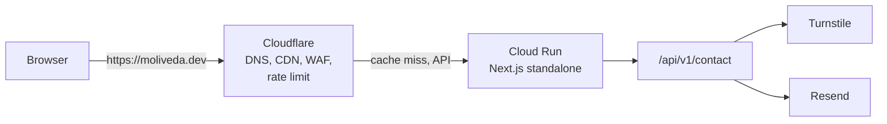

# moliveda_web

Personal portfolio of **Mauricio Oliveda**, a full-stack software developer. The site helps future clients and companies understand his skills, experience and education. It is available in English (default), Spanish, Portuguese and French through path-based locales (`/en`, `/es`, `/pt`, `/fr`), picks the best language from the browser's `Accept-Language` header on the first visit, offers a resume viewer and download in each language, and includes a contact form that delivers email through Resend. It runs on Google Cloud Run behind Cloudflare at [moliveda.dev](https://moliveda.dev).

> **Status:** planning. The architecture, decisions and roadmap are in [`MASTERPLAN.md`](./MASTERPLAN.md). Only the NGINX basic-auth gate is built so far. The commands below describe the scripts that will exist after Phase 1 of the plan.

## Table of contents

- [moliveda_web](#moliveda_web)
  - [Table of contents](#table-of-contents)
  - [Tools and technologies](#tools-and-technologies)
  - [Architecture](#architecture)
  - [Getting started](#getting-started)
    - [Requirements](#requirements)
    - [Install and run](#install-and-run)
  - [Scripts](#scripts)
  - [Docker operations 🐳](#docker-operations-)
    - [1. Local development (hot reloading)](#1-local-development-hot-reloading)
    - [2. Executing commands inside a container](#2-executing-commands-inside-a-container)
    - [3. Image targets](#3-image-targets)
    - [4. Development, staging and production](#4-development-staging-and-production)
  - [Environments and deployment](#environments-and-deployment)
  - [Environment variables](#environment-variables)
  - [Testing and quality](#testing-and-quality)
  - [Known gaps](#known-gaps)
  - [Contributions](#contributions)
  - [Assets and credits](#assets-and-credits)
  - [License](#license)

## Tools and technologies

| Area                 | Tools                                                                                                                                                   |
| -------------------- | ------------------------------------------------------------------------------------------------------------------------------------------------------- |
| Framework            | Next.js (App Router), React, TypeScript (`strict`)                                                                                                      |
| Styling and UI       | Tailwind CSS, components from the author's `origin-ui` design system on Base UI (rules in [`DESIGN.md`](./DESIGN.md)), Space Grotesk font, Lucide icons |
| Animation            | framer-motion (`LazyMotion`, reduced-motion aware)                                                                                                      |
| Internationalization | next-intl (path-based locales, `Accept-Language` negotiation, typed messages, all content in `messages/{locale}/`)                                      |
| Forms and validation | React Hook Form, Zod                                                                                                                                    |
| Backend              | Next.js Route Handlers, RESTful and versioned (`/api/v1/...`)                                                                                           |
| Email and anti-spam  | Resend, Cloudflare Turnstile, honeypot field, Cloudflare rate limiting                                                                                  |
| Edge                 | Cloudflare (DNS, CDN, WAF managed rules, redirect and cache rules)                                                                                      |
| Analytics            | Cloudflare Web Analytics (cookieless)                                                                                                                   |
| Logging              | Pino (structured JSON to stdout), Cloud Logging and Error Reporting                                                                                     |
| Testing              | Vitest, React Testing Library, msw, Playwright, axe, Lighthouse CI, Stryker (100% unit and integration coverage)                                        |
| Code quality         | ESLint, Prettier, Husky, lint-staged, gitleaks, Gitmoji commit messages                                                                                 |
| Containers           | Docker (multi-stage), Docker Compose for local development, NGINX basic-auth gate for non-production                                                    |
| Hosting and CI/CD    | Google Cloud Run (`us-central1`, one GCP project per environment), GitHub Actions, Docker Hub                                                           |
| Design               | Google Stitch (design source), design system rules and tokens in `DESIGN.md`                                                                            |

## Architecture



Development, preview and staging add an NGINX basic-auth gate as the ingress container in the same Cloud Run service:

```text
client ─► [ nginx gate :8080, basic auth ] ─► [ next app :3000 ]
```

All text a visitor reads, UI strings and personal content, lives in `messages/{locale}/` and is loaded through next-intl. See `MASTERPLAN.md` section 4 for the full design.

## Getting started

### Requirements

- Node.js 26 LTS (see `.nvmrc`) and npm. Needed on the host for the Git hooks even when you work in Docker.
- Docker and Docker Compose (the default way to run every check)
- A Resend API key and Cloudflare Turnstile keys, or the test values listed in [Environment variables](#environment-variables)

### Install and run

```bash
git clone https://github.com/M-oliveda/moliveda_web.git
cd moliveda_web
nvm use
npm ci                  # also installs the Husky hooks
cp .env.example .env    # then fill in the values
docker compose up --build   # http://localhost:3000 (redirects to /en, /es, /pt or /fr)
```

In VS Code, install the recommended extensions (Prettier and markdownlint) when prompted. The shared settings in `.vscode/` format on save and match the project's Markdown rules.

## Scripts

| Command                 | What it does                                                           |
| ----------------------- | ---------------------------------------------------------------------- |
| `npm run dev`           | Start the development server                                           |
| `npm run build`         | Create the production build                                            |
| `npm run start`         | Serve the production build                                             |
| `npm run verify`        | Run every gate below in order (what CI and the definition of done use) |
| `npm run lint`          | Run ESLint on the whole project (zero warnings)                        |
| `npm run format`        | Format all files with Prettier                                         |
| `npm run format:check`  | Check formatting without writing                                       |
| `npm run typecheck`     | Run `next typegen && tsc --noEmit`                                     |
| `npm run check:design`  | Fail on arbitrary colors or `dark:` color prefixes (see `DESIGN.md`)   |
| `npm run test`          | Run unit and integration tests once                                    |
| `npm run test:watch`    | Run tests in watch mode                                                |
| `npm run test:coverage` | Run tests and fail below 100% coverage                                 |
| `npm run test:e2e`      | Run Playwright end-to-end tests against a production build             |

Before opening a pull request, run `docker compose exec web npm run verify`.

Git hooks (Husky, run on the host): `pre-commit` blocks secret files, runs gitleaks, lint-staged and the typecheck; `commit-msg` enforces [Gitmoji](https://gitmoji.dev) messages (`:sparkles: Add experience page`); `pre-push` runs the tests related to your changes.

**Commits must be signed** (`git config commit.gpgsign true` with your GPG key). The rulesets on `main` and `develop` reject unsigned commits, and `pre-commit` fails early if signing is off.

## Docker operations 🐳

### 1. Local development (hot reloading)

This project uses a single `docker-compose.yaml` for local development only. It includes **bind mounts** for hot reloading and **exposed ports** (3000) for easy access. The same multi-stage `Dockerfile` is used for every environment.

- **Run (foreground):** `docker compose up --build`
  - _Builds the image if necessary and starts all services in the foreground. Press `Ctrl+C` to stop._
- **Run (detached):** `docker compose up -d`
  - _Starts services in the background._
- **Run with the basic-auth gate:** `docker compose --profile gate up --build`
  - _Starts the NGINX gate in front of the app at [http://localhost:8080](http://localhost:8080), as on the non-production environments. Credentials are optional locally: with `APP_ENV=local` and both `BASIC_AUTH_USERNAME` and `BASIC_AUTH_PASSWORD` unset, the gate starts open (it logs a warning) so you can check its headers and limits without a password. Set both in `.env` to test the login prompt._
- **Restart a service:** `docker compose restart web`
- **Stop all:** `docker compose down`
- **View logs:** `docker compose logs -f web`
  - _Streams live logs (omit the service name to see all logs)._

### 2. Executing commands inside a container

- **Run all checks:**

  ```bash
  docker compose exec web npm run verify
  ```

- **Run tests:**

  ```bash
  docker compose exec web npm run test
  ```

- **Run end-to-end tests** (separate Playwright service, Compose profile `e2e`):

  ```bash
  docker compose --profile e2e run --rm e2e
  ```

- If the stack is not running, use `docker compose run --rm web npm run <script>` instead of `exec`. If Docker is not installed, run the npm scripts directly on your machine.
- **Open an interactive shell** (the image is Alpine-based, so use `sh`):

  ```bash
  docker compose exec web sh
  ```

### 3. Image targets

```bash
# Production app image
docker build \
  --target runner \
  --build-arg APP_ENV=local \
  --build-arg NEXT_PUBLIC_SITE_URL=http://localhost:8080 \
  --build-arg NEXT_PUBLIC_TURNSTILE_SITE_KEY=<turnstile-test-site-key> \
  -t moliveda-web:local .
docker run --rm -p 8080:8080 --env-file .env moliveda-web:local

# Basic-auth gate (available now)
docker build --target gate -t moliveda-web-gate:local .
scripts/test-gate.sh    # builds the gate and checks 25 behaviors against a stub upstream
```

`NEXT_PUBLIC_*` values are inlined at build time, so they are passed as build arguments. Server secrets and the gate credentials are never build arguments. They are passed at runtime.

### 4. Development, staging and production

These environments do **not** use Docker Compose. They run on **Google Cloud Run**, deployed by GitHub Actions (see below).

## Environments and deployment

| Environment | Trigger                          | Access                     | URL                                                                      |
| ----------- | -------------------------------- | -------------------------- | ------------------------------------------------------------------------ |
| Development | push to `develop`                | basic auth (gate)          | default `*.run.app` URL, printed at the end of the CI/CD job             |
| Preview     | pull request (same repository)   | basic auth (gate)          | default `*.run.app` URL, posted on the PR and deleted when the PR closes |
| Staging     | push to `release/x.y.z`          | basic auth (gate)          | default `*.run.app` URL, printed at the end of the CI/CD job             |
| Production  | push to `main` (manual approval) | public, through Cloudflare | [https://moliveda.dev](https://moliveda.dev)                             |

- Deploys run only after the single required check, `CI passed`, succeeds.
- Images are pushed to public Docker Hub repositories and deployed to Cloud Run by digest. Production rolls out as a no-traffic candidate revision, is smoke-tested, then receives traffic.
- Development, preview and staging scale to zero (`min-instances 0`). Production runs with `min-instances 1` so one instance stays online.
- Every secret, including production runtime secrets, is a GitHub Environment secret. The environments are `develop`, `preview`, `staging` and `production`. Google Secret Manager is not used. Gate credentials differ in each non-production environment.
- **Releasing:** bump the version on a `release/x.y.z` branch (`npm version x.y.z --no-git-tag-version`), verify it on staging, then merge into `main`. The production workflow deploys, smoke-tests and only then creates the `vX.Y.Z` tag and GitHub Release.
- **Rollback:** send traffic back to the previous Cloud Run revision with `gcloud run services update-traffic`. The full commands are in `MASTERPLAN.md` section 10.7 and `docs/runbooks/`.

`MASTERPLAN.md` sections 10.1 to 10.7 describe the full pipeline, the Cloudflare setup and the GCP bootstrap.

## Environment variables

Copy `.env.example` to `.env` for local work. Never commit `.env`. In deployed environments the values come from GitHub Environment variables and secrets, including production.

`NEXT_PUBLIC_*` variables are public by design (they end up in the browser bundle) and are set at build time. All others are server-only and are read at runtime.

| Variable                         | Type   | Required                         | Example / allowed values                                     | Description                                                                                                                                                 |
| -------------------------------- | ------ | -------------------------------- | ------------------------------------------------------------ | ----------------------------------------------------------------------------------------------------------------------------------------------------------- |
| `APP_ENV`                        | server | yes                              | `local`, `development`, `preview`, `staging`, `production`   | Active environment. Non-production values add `noindex` headers and `Disallow: /` in `robots.txt`.                                                          |
| `LOG_LEVEL`                      | server | no                               | `info` (default), `warn`, `error`, `debug`                   | Pino log level. Keep `debug` off in production.                                                                                                             |
| `PORT`                           | server | no                               | `3000` locally and behind the gate, `8080` in production     | Port the server listens on.                                                                                                                                 |
| `NEXT_PUBLIC_SITE_URL`           | public | yes                              | `https://moliveda.dev`                                       | Canonical base URL for metadata, sitemap, Open Graph and the contact `Origin` check.                                                                        |
| `NEXT_PUBLIC_TURNSTILE_SITE_KEY` | public | yes                              | Cloudflare site key                                          | Turnstile widget key. Cloudflare's documented test key locally and in CI only.                                                                              |
| `NEXT_PUBLIC_CF_BEACON_TOKEN`    | public | production only                  | Cloudflare Web Analytics token                               | Leave empty elsewhere to disable analytics.                                                                                                                 |
| `TURNSTILE_SECRET_KEY`           | secret | yes                              | Cloudflare secret key                                        | Server-side Turnstile verification. Cloudflare's documented test secret locally and in CI only.                                                             |
| `RESEND_API_KEY`                 | secret | yes (when `EMAIL_DRIVER=resend`) | `re_...`                                                     | Resend API key.                                                                                                                                             |
| `EMAIL_DRIVER`                   | server | no                               | `resend` (default), `fake`                                   | `fake` records messages in memory. Used locally, in tests, and on development and preview.                                                                  |
| `CONTACT_FROM_EMAIL`             | server | yes                              | `contact@moliveda.dev`                                       | Sender address. The domain must be verified in Resend.                                                                                                      |
| `CONTACT_TO_EMAIL`               | server | yes                              | Owner inbox in production, `delivered@resend.dev` in staging | Where contact messages are delivered.                                                                                                                       |
| `RATE_LIMIT_MAX_REQUESTS`        | server | no                               | `5` (default)                                                | Max contact submissions per client IP per window, per instance.                                                                                             |
| `RATE_LIMIT_WINDOW_SECONDS`      | server | no                               | `600` (default)                                              | Rate limit window length.                                                                                                                                   |
| `BASIC_AUTH_USERNAME`            | secret | gate only                        | any name without `:`                                         | Gate user name. Required on development, preview and staging. Optional only when `APP_ENV=local` and the password is also unset.                            |
| `BASIC_AUTH_PASSWORD`            | secret | gate only                        | at most 72 bytes                                             | Gate password, bcrypt-hashed by the gate at start. Optional under the same rule as the user name. Wrap it in single quotes in `.env` if it contains `$`.    |
| `ORIGIN_VERIFY_SECRET`           | secret | production only                  | random, at least 32 bytes                                    | Value Cloudflare adds as `X-Origin-Verify`. Production answers `403` to requests without it (probes exempt). Stored in the `production` GitHub Environment. |
| `ORIGIN_VERIFY_SECRET_PREVIOUS`  | secret | no                               | the previous value                                           | Accepted alongside the current value while the secret is rotated. Remove it afterwards.                                                                     |
| `UPSTREAM`                       | gate   | no                               | `127.0.0.1:3000` (default), `web:3000` in Compose            | Where the gate forwards authenticated requests.                                                                                                             |
| `GATE_PORT`                      | local  | no                               | `8080` (default)                                             | Host port for the local `gate` profile.                                                                                                                     |

The app validates these with Zod and **refuses to start** in any non-local environment if a required value is missing. The gate fails closed too: it refuses to start without both credentials, unless `APP_ENV=local` and both are unset, in which case it starts with basic auth disabled. Setting only one of the two is always an error.

CI/CD also uses repository and environment settings that are not app variables: `DOCKERHUB_USERNAME`, `DOCKERHUB_TOKEN`, `DOCKERHUB_CLEANUP_TOKEN`, `GCP_PROJECT_ID`, `GCP_REGION`, `GCP_WORKLOAD_IDENTITY_PROVIDER` and `GCP_SERVICE_ACCOUNT`. They are listed in `MASTERPLAN.md` section 10.3.

## Testing and quality

- **Unit and integration:** Vitest and React Testing Library with a **100%** coverage gate. The only exceptions are file-level exclusions in `vitest.config.ts`, each justified in a comment.
- **End to end:** Playwright against the production build, with axe on every page, locale and theme, a keyboard walk that checks every focus ring, visual snapshots, a CSP violation check and a run with JavaScript disabled.
- **Performance:** Lighthouse CI on the production build. Accessibility, Best Practices and SEO must be 100 and CLS under 0.05; Performance targets 95.
- **Containers:** CI boots the production image as non-root and runs `scripts/test-gate.sh` against the gate.
- **Accessibility target:** WCAG 2.2 AA.

Measured results (test counts, coverage, Lighthouse scores) will be recorded here, with dates, once the first pages ship.

## Known gaps

Tracked from the start and updated with every phase:

- In-memory rate limiting is per Cloud Run instance. Cloudflare's edge rate limit and Turnstile are the primary defenses.
- `NEXT_PUBLIC_*` values are baked into the build, so each environment gets its own image. The production image is built from the same commit, lockfile and base image digests as staging, but it is not the exact image verified there.
- Cloud Run domain mapping is a Google Preview feature. Cloudflare caches the pages, so most requests never reach it.
- Secrets injected into Cloud Run are visible to anyone with view access to that service, including production. Each environment has its own values. Google Secret Manager is not used.
- Docker Hub is the only registry. Cloud Run may cache Docker Hub images for up to an hour; deploys are pinned by digest.
- Release tags are created by the production workflow with `GITHUB_TOKEN`, so they are not GPG-signed.
- Until `ci.yml` exists (Phase 1), the `main` and `develop` rulesets require a pull request and signed commits but no status check.
- The French, Spanish and Portuguese text needs a native-speaker review before launch (status in `messages/REVIEW.md`).

## Contributions

This is a personal portfolio, so outside contributions (pull requests, issues, feature requests) are not accepted. You are welcome to read the code and learn from it under the terms of the license. To report a security problem, follow [`SECURITY.md`](./SECURITY.md).

## Assets and credits

- **Font:** [Space Grotesk](https://github.com/floriankarsten/space-grotesk) (SIL Open Font License 1.1), self-hosted through `next/font`.
- **Icons:** [Lucide](https://lucide.dev) (ISC license).
- **Components:** the author's `origin-ui` design system, built on [shadcn/ui](https://ui.shadcn.com) and [Base UI](https://base-ui.com) (MIT, see [`THIRD_PARTY_NOTICES.md`](./THIRD_PARTY_NOTICES.md)).
- **Photos and resume:** the author's own, under the content license below.

## License

- **Source code:** GNU Affero General Public License v3.0 only (`AGPL-3.0-only`). See [`LICENSE`](./LICENSE).
- **Personal content** (text under `messages/*/content/`, the profile photo in `public/profile/`, the resume PDFs in `public/cv/`, and the author's name and likeness): **All Rights Reserved**. The AGPL does not apply to these paths. You may not copy, modify or redistribute them without written permission. Forks must replace this content.
- Third-party components keep their original licenses. See [`THIRD_PARTY_NOTICES.md`](./THIRD_PARTY_NOTICES.md).
- The split is described in machine-readable form in `REUSE.toml`.
